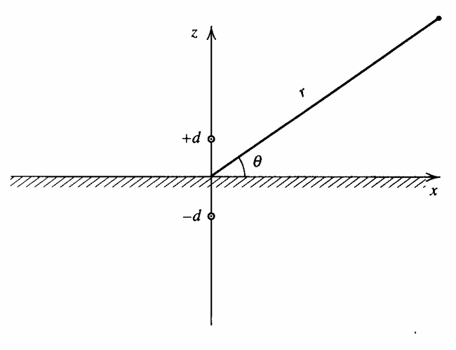

The equations we've derived so far have only been focused on wave propagation through a single medium. Now, we may consider the acoustics of waves propagating through two different media.

# Changes in Media {#sec-changes-in-media}

Reflected and transmitted waves are generated when an acoustic wave encounters a boundary between two media. These are waves that are reflected back towards the source and transmitted through the boundary into the new medium. We first focus on wave propagation through a fluid-fluid boundary before investigating how the equations change for fluid-solid boundaries.

::: {.callout-note title="Effects of Fluid-Fluid vs. Fluid-Solid Boundaries"}
For pressure waves propagating perpendicular to a boundary, many fluid-solid boundaries can be analyzed using the same equations as fluid-fluid boundaries. The speed of sound in an extended solid must be the *bulk longitudinal wave speed*, which accounts for both the bulk and shear moduli, instead of the bar speed.
:::

Let the medium of the incident (and reflected) wave have an impedance of $r_1=\rho_1c_1$, where $\rho_1$ is the equilibrium density of the fluid. And let the medium of the transmitted wave have an impedance of $r_2=\rho_2c_2$. If the complex pressures of the incident, reflected, and transmitted waves are $\textbf P_i$, $\textbf P_r$, and $\textbf P_t$, then the *pressure transmission and reflection coefficients* are

$$
\begin{aligned}
\textbf T & =\frac {\textbf P_t}{\textbf P_i} \\
\textbf R & =\frac {\textbf P_r}{\textbf P_i}
\end{aligned}
$$ {#eq-transmission-reflection-coefficients}

These ratios indicate how the complex pressure changes across an interface for transmitted and reflected waves. For harmonic progressive plane waves, recall that $I=|\textbf P|^2/(2r)$. We may define the *intensity transmission and reflection coefficients* as

$$
\begin{aligned}
T_I & =\frac {I_t}{I_i}=\frac {r_1}{r_2}|\textbf T|^2 \\
R_I & =\frac {I_r}{I_i}=|\textbf R|^2
\end{aligned}
$$ {#eq-intensity-transmission-reflection-coefficients}

The intensity coefficients are *purely real* and are therefore not bolded. The power associated with a sound wave is $IA$, where $A$ is the cross-sectional area perpendicular to the direction of propagation of its beam. For oblique incidence, $A_t$ is generally different from $A_i$. However, we will later show that $A_r=A_i$.

::: {.callout-note title="Cross-Sectional Areas of Beams"}
Most real situations have beams with finite cross-sectional areas. Locally, a sufficiently broad beam has nearly parallel rays and can be approximated by a plane wave. Diffraction near the edges may be neglected when the beam dimensions are large compared with the wavelength. For oblique incidence, remember that intensity is measured along a beam, whereas power is measured over its *own* cross-section.
:::

We may define the *power transmission and reflection coefficients* as

$$
\begin{aligned}
T_{\Pi} & =\frac {A_t}{A_i}T_I=\frac {A_tr_1}{A_ir_2}|\textbf T|^2 \\
R_{\Pi} & =R_I=|\textbf R|^2
\end{aligned}
$$ {#eq-power-transmission-reflection-coefficients}

Assuming a lossless boundary, the incident power must be shared between the transmitted and reflected beams:

$$
\boxed{T_{\Pi}+R_{\Pi}=1}
$$ {#eq-power-conservation-reflection-transmitted-coefficient}

# Transmission From One Fluid to Another: Normal Incidence

Let $x=0$ be the boundary between fluid $1$, with characteristic impedance $r_1=\rho_1c_1$, and fluid $2$, with characteristic impedance $r_2=\rho_2c_2$. Assume the incident wave propagates in the $+x$ direction. For plane waves, we have

$$
\begin{aligned}
\textbf p_i & =\textbf P_ie^{j(\omega t-k_1x)} \\
\textbf p_r & =\textbf P_re^{j(\omega t+k_1x)} \\
\textbf p_t & =\textbf P_te^{j(\omega t-k_2x)}
\end{aligned}
$$ {#eq-normal-incidence-plane-waves}

Since $\textbf p_r$ propagates in the $-x$ direction in medium $1$, we have $\omega t\textcolor{red}{+}k_1x$. Since $\textbf p_t$ propagates through medium $2$, we use $\omega t-k_{\textcolor{red}{2}}x$. All waves have the same $f$ and $\omega$, but the wave numbers $k_m=\omega/c_m$ may differ.

Two boundary conditions must be satisfied at the interface:

1. **Continuity of pressure:** The acoustic pressures on both sides must be equal, since there can be no net force on an imaginary, massless interface.
2. **Continuity of normal particle velocity:** The normal components of particle velocity must agree, since the two fluids remain in contact.

Mathematically, the boundary conditions are

$$
\begin{aligned}
\textbf p_i(0)+\textbf p_r(0) & =\textbf p_t(0) \\
\textbf u_i(0)+\textbf u_r(0) & =\textbf u_t(0)
\end{aligned}
$$ {#eq-normal-incidence-boundary-conditions}

Dividing the two equations in @eq-normal-incidence-boundary-conditions gives the *continuity of normal specific acoustic impedance* across the interface.

$$
\frac {\textbf p_i(0)+\textbf p_r(0)}{\textbf u_i(0)+\textbf u_r(0)}=\frac {\textbf p_t(0)}{\textbf u_t(0)}
$$ {#eq-normal-incidence-continuity-normal-specific-impedance}

Since $\textbf p/\textbf u=\pm r$ for progressive plane waves, @eq-normal-incidence-continuity-normal-specific-impedance becomes

$$
r_1\frac {\textbf p_i(0)+\textbf p_r(0)}{\textbf p_i(0)-\textbf p_r(0)}=r_2
$$

Normalizing by $\textbf p_i$ gives the pressure reflection coefficient:

$$
\boxed{\textbf R=\frac {r_2-r_1}{r_2+r_1}=\frac {r_2/r_1-1}{r_2/r_1+1}}
$$ {#eq-normal-incidence-reflection-coefficient}

From continuity of pressure, we obtain

$$
\boxed{\textbf T=1+\textbf R=\frac {2r_2}{r_2+r_1}=\frac {2r_2/r_1}{r_2/r_1+1}}
$$ {#eq-normal-incidence-transmission-coefficient}

The intensity coefficients, from @eq-intensity-transmission-reflection-coefficients, are

$$
\begin{gathered}
\boxed{\displaystyle R_I=\left(\frac{r_2/r_1-1}{r_2/r_1+1}\right)^2}\\[12pt]
\boxed{\displaystyle \mathrlap{T_I=\frac{4r_2/r_1}{\left(r_2/r_1+1\right)^2}}\phantom{R_I=\left(\frac{r_2/r_1-1}{r_2/r_1+1}\right)^2}}
\end{gathered}
$$ {#eq-normal-incidence-intensity-coefficients}

For normal incidence, $A_t=A_i$ and the power coefficients are equal to the intensity coefficients:

$$
\begin{gathered}
\boxed{\displaystyle R_{\Pi}=R_I=\left(\frac{r_2/r_1-1}{r_2/r_1+1}\right)^2}\\[12pt]
\boxed{\displaystyle \mathrlap{T_{\Pi}=T_I=\frac{4r_2/r_1}{\left(r_2/r_1+1\right)^2}}\phantom{R_{\Pi}=R_I=\left(\frac{r_2/r_1-1}{r_2/r_1+1}\right)^2}}
\end{gathered}
$$ {#eq-normal-incidence-power-coefficients}

::: {.callout-note title="Interpreting the Pressure Coefficients"}
The sign of $\textbf R$ indicates the phase of reflected *pressure* at the boundary:

- If $r_2>r_1$, then $\textbf R>0$: the reflected pressure is in phase with the incident pressure.
- If $r_2<r_1$, then $\textbf R<0$: the reflected pressure is $180^\circ$ out of phase.
- If $r_2=r_1$, then $\textbf R=0$ and the wave is completely transmitted.

The transmitted-pressure coefficient $\textbf T$ is positive for positive real impedances. It can exceed $1$ without violating energy conservation, since *pressure amplitude is not power*. The intensity coefficients are unchanged when the direction of transmission is reversed, even though the pressure coefficients change.
:::

The limiting cases are also useful. A very large impedance in medium 2 acts as a *rigid boundary*, whereas a very small impedance acts as a *pressure-release boundary*:

$$
\begin{aligned}
\boxed{r_2/r_1\to\infty:\quad \textbf R\to+1,\quad\textbf T\to2}\\[12pt]
\boxed{r_2/r_1\to0:\quad \textbf R\to-1,\quad\textbf T\to0}
\end{aligned}
$$ {#eq-normal-incidence-limiting-boundaries}

At a rigid boundary, the normal particle velocity vanishes; at a pressure-release boundary, the total acoustic pressure vanishes. In both limits, $R_I\to1$ and $T_I\to0$.

# Transmission Through a Fluid Layer: Normal Incidence

Now let a uniform layer of medium $2$, with thickness $L$ and impedance $r_2$, lie between media $1$ and $3$ (impedances $r_1$ and $r_3$). The first boundary is located at $x=0$ and the second at $x=L$. Each interface reflects part of a wave, so the intermediate layer contains waves traveling in **both** directions.

An incident pulse shorter than the round-trip time of the layer gives a sequence of separate echoes, spaced by

$$
\boxed{\Delta t=\frac{2L}{c_2}}
$$ {#eq-fluid-layer-echo-spacing}

For a much longer harmonic wave train, the multiple reflections overlap and produce a steady-state interference pattern. We write the five waves as

$$
\begin{aligned}
\textbf p_i&=\textbf P_i e^{j(\omega t-k_1x)} & \textbf p_r&=\textbf P_r e^{j(\omega t+k_1x)}\\
\textbf p_a&=\textbf A e^{j(\omega t-k_2x)} & \textbf p_b&=\textbf B e^{j(\omega t+k_2x)}\\
\textbf p_t&=\textbf P_t e^{j(\omega t-k_3x)}
\end{aligned}
$$ {#eq-fluid-layer-wave-fields}

Here, $a$ and $b$ denote the rightward- and leftward-traveling waves within the layer. Continuity of pressure and normal velocity must hold at **both** boundaries. Eliminating $\textbf A$ and $\textbf B$ yields the pressure reflection coefficient (with $\textbf R=\textbf P_r/\textbf P_i$):

$$
\boxed{\textbf R=\frac{(1-r_1/r_3)\cos(k_2L)+j(r_2/r_3-r_1/r_2)\sin(k_2L)}{(1+r_1/r_3)\cos(k_2L)+j(r_2/r_3+r_1/r_2)\sin(k_2L)}}
$$ {#eq-fluid-layer-reflection-coefficient}

Unlike normal reflection from a single ideal fluid-fluid boundary, $\textbf R$ may now be *complex* because the internal reflections create a phase shift. With equal beam areas on both sides, the power and intensity transmission coefficients are equal:

$$
\boxed{T_{\Pi}=T_I=\frac{4}{2+\left(\frac{r_3}{r_1}+\frac{r_1}{r_3}\right)\cos^2(k_2L)+\left(\frac{r_2^2}{r_1r_3}+\frac{r_1r_3}{r_2^2}\right)\sin^2(k_2L)}}
$$ {#eq-fluid-layer-transmission-coefficient}

Since the model is lossless, $R_I=R_{\Pi}=1-T_I$, as in @eq-power-conservation-reflection-transmitted-coefficient.

## Same Medium on Both Sides

An important special case occurs when $r_1=r_3$. Simplifying @eq-fluid-layer-transmission-coefficient gives

$$
\boxed{T_I=\frac{1}{1+\frac14\left(\frac{r_2}{r_1}-\frac{r_1}{r_2}\right)^2\sin^2(k_2L)}}
$$ {#eq-fluid-layer-symmetric-transmission}

If $r_2\gg r_1$, we can neglect the smaller impedance-ratio term:

$$
T_I\approx\frac{1}{1+\frac14(r_2/r_1)^2\sin^2(k_2L)}
$$ {#eq-fluid-layer-large-impedance-approximation}

Provided $|(r_2/r_1)\sin(k_2L)|\gg2$, and if the layer is also acoustically thin, $k_2L\ll1$, this becomes

$$
\boxed{T_I\approx\left(\frac{2r_1}{r_2k_2L}\right)^2=\left(\frac{2r_1}{\omega\rho_2L}\right)^2}
$$ {#eq-fluid-layer-thin-heavy-layer-transmission}

This explains why, for fixed material properties, making a sufficiently thin heavy wall thicker decreases its transmission. The approximation requires **both** the large-mismatch condition and $k_2L\ll1$; a sufficiently thin membrane at low frequency may instead become nearly transparent.

::: {.callout-note title="A Thin Layer Does Not Always Block Sound"}
For a layer with $r_1=r_3$, if the impedance contrast is such that $|(r_2/r_1-r_1/r_2)\sin(k_2L)|\ll2$, then @eq-fluid-layer-symmetric-transmission gives $T_I\approx1$. It is the combined effect of impedance *and* thickness, not impedance alone, that governs the transmission.
:::

## Half-Wavelength and Quarter-Wavelength Layers

At integral half-wavelength thicknesses, $k_2L=n\pi$, where $n=1,2,\ldots$, the sine term in @eq-fluid-layer-transmission-coefficient vanishes. The intermediate layer behaves, in terms of power transmission, as though the outer media were in direct contact:

$$
\boxed{L=\frac{n\lambda_2}{2}\quad\Longrightarrow\quad T_I=\frac{4r_1r_3}{(r_1+r_3)^2}}
$$ {#eq-fluid-layer-half-wave}

At odd quarter-wavelength thicknesses, $k_2L=(2n-1)\pi/2$, the cosine term vanishes:

$$
\boxed{L=\frac{(2n-1)\lambda_2}{4}\quad\Longrightarrow\quad T_I=\frac{4r_1r_3}{\left(r_2+\frac{r_1r_3}{r_2}\right)^2}}
$$ {#eq-fluid-layer-quarter-wave}

There is **perfect power transmission** at these quarter-wavelength frequencies if the intermediate impedance is the geometric mean of the outer impedances:

$$
\boxed{r_2=\sqrt{r_1r_3}\quad\Longrightarrow\quad T_I=1}
$$ {#eq-fluid-layer-quarter-wave-matching}

This is known as *quarter-wave impedance matching*. The effect is frequency-selective, since $\lambda_2=c_2/f$. Finally, the entire layer may be viewed from medium $1$ as an equivalent input impedance:

$$
\boxed{\textbf z_{\mathrm{in}}=r_1\frac{1+\textbf R}{1-\textbf R}}
$$ {#eq-fluid-layer-input-impedance}

For layered interfaces, this is especially useful because the effect of several boundaries can be replaced by one generally complex input impedance.

# Transmission From One Fluid to Another: Oblique Incidence

We now relax the assumption that the wave strikes the interface perpendicularly. Let $\theta_i$, $\theta_r$, and $\theta_t$ be the angles the incident, reflected, and transmitted waves make with the **normal** to the plane $x=0$.

For propagation in the $xy$-plane, the pressure fields are

$$
\begin{aligned}
\textbf p_i&=\textbf P_i e^{j(\omega t-k_1x\cos\theta_i-k_1y\sin\theta_i)}\\
\textbf p_r&=\textbf P_r e^{j(\omega t+k_1x\cos\theta_r-k_1y\sin\theta_r)}\\
\textbf p_t&=\textbf P_t e^{j(\omega t-k_2x\cos\theta_t-k_2y\sin\theta_t)}
\end{aligned}
$$ {#eq-oblique-incidence-plane-waves}

Continuity of pressure at *every* point along the interface requires the tangential wave numbers to be identical, giving the law of reflection and **Snell's law**:

$$
\begin{gathered}
\boxed{\theta_r=\theta_i}\\[12pt]
\boxed{\displaystyle\frac{\sin\theta_i}{c_1}=\frac{\sin\theta_t}{c_2}}
\end{gathered}
$$ {#eq-oblique-incidence-snell-law}

In particular, the transmitted angle is determined by the sound speeds, whereas the reflected angle always equals the incident angle. Using @eq-oblique-incidence-snell-law, the two interface conditions reduce to

$$
\begin{aligned}
1+\textbf R&=\textbf T\\
1-\textbf R&=\frac{r_1\cos\theta_t}{r_2\cos\theta_i}\textbf T
\end{aligned}
$$ {#eq-oblique-incidence-boundary-conditions}

Solving gives the *Rayleigh pressure reflection coefficient* and corresponding pressure transmission coefficient:

$$
\boxed{\textbf R=\frac{r_2/\cos\theta_t-r_1/\cos\theta_i}{r_2/\cos\theta_t+r_1/\cos\theta_i}=\frac{r_2\cos\theta_i-r_1\cos\theta_t}{r_2\cos\theta_i+r_1\cos\theta_t}}
$$ {#eq-oblique-incidence-reflection-coefficient}

$$
\boxed{\textbf T=1+\textbf R=\frac{2r_2\cos\theta_i}{r_2\cos\theta_i+r_1\cos\theta_t}}
$$ {#eq-oblique-incidence-transmission-coefficient}

These reduce to @eq-normal-incidence-reflection-coefficient and @eq-normal-incidence-transmission-coefficient when $\theta_i=\theta_t=0$. When the transmitted wave propagates away from the boundary, the intensity and power ratios differ because the beam cross-sections differ:

$$
\begin{aligned}
T_I&=\frac{r_1}{r_2}|\textbf T|^2\\
\frac{A_t}{A_i}&=\frac{\cos\theta_t}{\cos\theta_i}
\end{aligned}
$$ {#eq-oblique-incidence-beam-area-ratio}

Thus, for a *real* transmitted angle, the power transmission coefficient is

$$
\boxed{T_{\Pi}=\frac{4\frac{r_2}{r_1}\frac{\cos\theta_t}{\cos\theta_i}}{\left(\frac{r_2}{r_1}+\frac{\cos\theta_t}{\cos\theta_i}\right)^2}}
$$ {#eq-oblique-incidence-power-transmission}

The power reflection coefficient remains $R_{\Pi}=|\textbf R|^2$, and $R_{\Pi}+T_{\Pi}=1$ for a lossless interface. The special case $r_2/\cos\theta_t=r_1/\cos\theta_i$ makes $\textbf R=0$, producing complete power transmission at the *angle of intromission* (when a physical angle satisfying this relation exists).

## Critical Angle and Total Internal Reflection

From Snell's law,

$$
\cos\theta_t=\sqrt{1-\left(\frac{c_2}{c_1}\right)^2\sin^2\theta_i}
$$ {#eq-oblique-incidence-transmitted-angle}

If $c_2<c_1$, the transmitted wave bends *toward* the normal. If $c_2>c_1$, it bends *away* from the normal and there is a *critical angle*:

$$
\boxed{\theta_c=\sin^{-1}\left(\frac{c_1}{c_2}\right)\qquad(c_2>c_1)}
$$ {#eq-oblique-incidence-critical-angle}

When $\theta_i>\theta_c$, the square root in @eq-oblique-incidence-transmitted-angle becomes imaginary. The transmitted pressure has the form

$$
\textbf p_t=\textbf P_t e^{-\gamma x}e^{j(\omega t-k_1y\sin\theta_i)},\qquad
\gamma=k_2\sqrt{\left(\frac{c_2}{c_1}\right)^2\sin^2\theta_i-1}
$$ {#eq-oblique-incidence-evanescent-wave}

The wave is *evanescent*: its amplitude decays exponentially perpendicular to the interface while its phase travels along the interface. For an ideal infinite lossless boundary, it carries no **time-averaged power away from the boundary**. Consequently,

$$
\boxed{\theta_i>\theta_c:\qquad |\textbf R|=1,\quad R_{\Pi}=1,\quad T_{\Pi}=0}
$$ {#eq-oblique-incidence-total-reflection}

The reflected wave may nevertheless acquire a nonzero phase shift, $\textbf R=e^{j\phi}$. Near the critical angle the reflected pressure is approximately in phase, while at grazing incidence ($\theta_i\to90^\circ$) the reflection coefficient tends toward $-1$.

::: {.callout-note title="Intensity Is Not the Same as Power at Oblique Incidence"}
Do not use $T_I+R_I=1$ for general oblique incidence. The correct conservation statement is @eq-power-conservation-reflection-transmitted-coefficient. In particular, an evanescent transmitted field can have nonzero acoustic pressure without transporting net power across the interface.
:::

# Normal Specific Acoustic Impedance

The *normal specific acoustic impedance* is the acoustic pressure divided by the component of particle velocity perpendicular to the surface. If $\hat n$ is its unit normal, then

$$
\boxed{\textbf z_n=\frac{\textbf p}{\vec{\textbf u}\cdot\hat n}}
$$ {#eq-normal-specific-impedance-definition}

For a single progressive wave making an angle $\theta$ with the normal, the impedance magnitude is $r/\cos\theta$. For an arbitrary surface with normal impedance $\textbf z_n$, the reflection coefficient can be written as

$$
\boxed{\textbf R=\frac{\textbf z_n-r_1/\cos\theta_i}{\textbf z_n+r_1/\cos\theta_i}}
$$ {#eq-normal-specific-impedance-reflection}

For a second ideal fluid with a propagating transmitted wave, $\textbf z_n=r_2/\cos\theta_t$, recovering @eq-oblique-incidence-reflection-coefficient. When the surface exhibits a phase shift between pressure and velocity, however, its impedance is generally complex:

$$
\boxed{\textbf z_n=r_n+jx_n}
$$ {#eq-normal-specific-impedance-complex}

Here $r_n$ is the *normal specific acoustic resistance*, associated with net power entering the surface, and $x_n$ is the *normal specific acoustic reactance*, associated with energy stored and returned to the incident medium.

# Reflection From the Surface of a Solid

Unlike fluids, elastic solids can support both longitudinal and transverse (*shear*) waves. An extended isotropic solid uses the *bulk longitudinal speed*, not the speed of sound along a thin bar:

$$
\boxed{c_L=\sqrt{\frac{K+\frac43G}{\rho_s}}}
$$ {#eq-solid-bulk-longitudinal-speed}

Here $K$ is the bulk modulus, $G$ the shear modulus, and $\rho_s$ the mass density of the solid. The material may present a complex normal surface impedance because its deformation and internal wave propagation need not follow the incident fluid motion exactly.

## Normal Incidence

Let the incident fluid have characteristic impedance $r_1$ and let the solid present $\textbf z_n=r_n+jx_n$. Setting $\theta_i=0$ in @eq-normal-specific-impedance-reflection gives

$$
\boxed{\textbf R=\frac{r_n-r_1+jx_n}{r_n+r_1+jx_n}}
$$ {#eq-solid-normal-incidence-reflection}

Its intensity reflection coefficient is

$$
\boxed{R_I=\frac{(r_n-r_1)^2+x_n^2}{(r_n+r_1)^2+x_n^2}}
$$ {#eq-solid-normal-incidence-intensity-reflection}

For a passive surface, the fraction of incident power *entering* the solid is

$$
\boxed{T_{\Pi}=1-R_I=\frac{4r_nr_1}{(r_n+r_1)^2+x_n^2}}
$$ {#eq-solid-normal-incidence-power-transmission}

This is power crossing the boundary; in a lossy solid, it should not automatically be interpreted as power reaching the other side. When $x_n=0$ and $r_n$ is the solid's characteristic impedance, the expressions reduce to the normal-incidence fluid results.

## Oblique Incidence

For a solid surface, oblique incidence may excite multiple types of motion. The behavior depends on the structure of the material:

1. A *locally reacting* surface responds primarily with normal motion, as in certain porous absorbers and acoustic tiles. An impedance boundary model, @eq-normal-specific-impedance-reflection, can be useful.
2. A material that behaves approximately like a fluid may be modeled by the refraction relations of the previous section.
3. An extended elastic solid may support **both longitudinal and shear transmitted waves**, which generally have different speeds and angles. A complete solution must satisfy the additional elastic boundary conditions.

::: {.callout-note title="When Can a Solid Be Treated Like a Fluid?"}
At normal incidence, a suitable longitudinal-wave impedance may be enough. At oblique incidence into an elastic solid, applying only the two-fluid equation can neglect shear-wave conversion and yield the wrong reflection coefficient.
:::

# Transmission Through a Thin Partition: The Mass Law

The case of wave propagation through a thin medium between two enclosures is of significant interest in architectural acoustics, where offices are separated by a thin wall. Assume the same fluid, with impedance $r_1=\rho_1c_1$, exists on both sides of a flexible partition. Let the partition have thickness $L$ much smaller than its internal wavelength and *surface mass density* $m_s=\rho_sL$ in $\mathrm{kg/m^2}$.

The partition is modeled as a mass moving in the normal direction, without stiffness, damping, or bending-wave resonance. Continuity of normal velocity gives

$$
\frac{(\textbf P_i-\textbf P_r)\cos\theta_i}{r_1}=\frac{\textbf P_t\cos\theta_i}{r_1},\qquad
\textbf T=1-\textbf R
$$ {#eq-mass-law-velocity-continuity}

The net pressure force per unit area must accelerate the partition:

$$
\textbf p_i+\textbf p_r-\textbf p_t=j\omega m_s\textbf u_n
$$ {#eq-mass-law-pressure-jump}

Combining the boundary conditions and using $\textbf T=\textbf P_t/\textbf P_i$, we obtain

$$
\boxed{\textbf T=\frac{2r_1}{2r_1+j\omega m_s\cos\theta_i}}
$$ {#eq-mass-law-pressure-transmission}

Since the incident and transmitted media are identical, the directions of propagation are the same and $T_{\Pi}=T_I=|\textbf T|^2$. Therefore,

$$
\boxed{T_I=\frac{1}{1+\left(\frac{\omega m_s\cos\theta_i}{2r_1}\right)^2}}
$$ {#eq-mass-law-intensity-transmission}

The *transmission loss* in decibels is the reduction of transmitted power relative to the incident power:

$$
\boxed{TL=10\log_{10}\left(\frac1{T_{\Pi}}\right)=10\log_{10}\left[1+\left(\frac{\omega m_s\cos\theta_i}{2r_1}\right)^2\right]}
$$ {#eq-mass-law-transmission-loss}

For normal incidence, $\theta_i=0$. In the high mass-frequency regime, $\omega m_s\gg2r_1$, the familiar **mass law** follows:

$$
\boxed{TL\approx20\log_{10}\left(\frac{\pi f m_s}{r_1}\right)}
$$ {#eq-mass-law-high-frequency}

Doubling either frequency $f$ or surface mass density $m_s$ therefore increases transmission loss by approximately **6 dB**. This is a useful first estimate, but actual walls may deviate because of bending stiffness, resonances, coincidence effects, leaks, or structural paths around the partition.

::: {.callout-note title="Mass Law vs. Layer Transmission"}
The partition model treats the layer as an accelerating surface mass and neglects internal wave propagation. The full fluid-layer model in @eq-fluid-layer-transmission-coefficient instead retains wave interference across a finite thickness. Their simplified expressions are useful in different physical limits.
:::

# Method of Images

Up until now, the focus of the reflected and transmitted waves has been on harmonic plane waves at plane interfaces. In this section, we will investigate the reflection of spherical waves at plane interfaces.

Let's consider a perfectly reflecting boundary (e.g., air-water interface), where no waves are transmitted through the boundary. These types of interfaces can be solved using the *method of images*. Taking the case of a single plane boundary in @sec-changes-in-media, we replace fluid $2$ with fluid $1$ and remove the physical boundary. We then introduce a fictitious source, called an *image*, across the imaginary interface with carefully selected strength and location such that the boundary conditions to the acoustic field are satisfied in fluid $1$. The acoustic field in fluid $2$ will *not* be correctly represented.

## Rigid Boundary

Consider a coordinate system set up such that the boundary between two media spans the $xy$ plane with the $+z$ axis pointing normally upwards. Assume the origin is located directly beneath the source of the spherical waves at a distance $d$, such that the source has position $(0, 0, d)$. We assume fluid $1$ is the real fluid, which covers the region $z>0$, and fluid $2$ will be the mirror fluid, which covers the region $z<0$. We will determine the acoustic field of an arbitrary point a distance $r$ away from the origin angled $\theta$ with respect to the $xy$ plane (see the image below).

{width=50% .lightbox}

Define $r_-$ as the distance between the real source and an arbitrary point. By the distance formula, $r_-^2=x^2+y^2+(z-d)^2$ and the pressure for a spherical wave is then

$$
\begin{aligned}
r_- & =\sqrt{x^2+y^2+(z-d)^2} \\
\textbf p_i & =\frac A{r_-}e^{j(\omega t-kr_-)}
\end{aligned}
$$ {#eq-real-source-pressure}

If we place the image source of equal strength, frequency, and initial phase angle, at $(0, 0, -d)$ (a mirror of the real source), then the normal component of the particle velocity disappears in the $xy$ plane. Using $r_+$ to denote the distance from the image source, then

$$
\begin{aligned}
r_+ & =\sqrt{x^2+y^2+(z+d)^2} \\
\textbf p_r & =\frac A{r_+}e^{j(\omega t-kr_+)}
\end{aligned}
$$ {#eq-image-source-pressure}

Since there is no normal particle velocity component, we may treat the boundary between the real and mirror media as a rigid boundary at $z=0$. There is, however, still a particle velocity component *parallel* to this boundary. The pressure in fluid $1$, $z>0$, is determined by summing @eq-real-source-pressure and @eq-image-source-pressure.

$$
\textbf p=\textbf p_i+\textbf p_r=A\left(\frac {e^{-jkr_-}}{r_-}+\frac {e^{-jkr_+}}{r_+}\right)e^{j\omega t}
$$ {#eq-rigid-boundary-pressure}

We can plot @eq-rigid-boundary-pressure to observe the pressure field using any plotting tool. However, we can derive analytical solutions by considering cases where $r\gg d\cos\theta$ in the farfield. The angle $\theta$ is called the grazing angle as it is the angle with respect to the boundary. For this approximation, we have

$$
\begin{aligned}
\Delta r & \approx d\sin\theta \\
r_- & \approx r-\Delta r \\
r_+ & \approx r+\Delta r
\end{aligned}
$$

Substituting into @eq-rigid-boundary-pressure gives

$$
\textbf p(r,\theta,t)\approx\frac Are^{j(\omega t-kr)}\left(\frac {e^{jk\Delta r}}{1-\Delta r/r}+\frac {e^{-jk\Delta r}}{1+\Delta r/r}\right)
$$

## Pressure Release Boundary

A pressure-release plane has zero total acoustic pressure at its surface. The image must be **180 degrees out of phase** with the real source, corresponding to the minus sign:

$$
\boxed{\textbf p_{\mathrm{release}}=\textbf C e^{j\omega t}\left(\frac{e^{-jkR_+}}{R_+}-\frac{e^{-jkR_-}}{R_-}\right)}
$$ {#eq-images-pressure-release-boundary}

On $z=0$, $R_+=R_-$, so @eq-images-pressure-release-boundary gives zero acoustic pressure. Away from the surface, the two contributions interfere. A real source together with an opposite-phase image is an *acoustic dipole*, and reflection from a water-air surface is an important approximation of this type.

## Extensions

In the far field, let $r$ be the observation distance from the midpoint between source and image, and let $\theta$ be measured from the boundary normal. For $r\gg d$, the distances are approximately $R_\pm\approx r\mp d\cos\theta$. Factoring out the common spherical-wave term gives

$$
\begin{aligned}
\textbf p_{\mathrm{rigid}}&\approx\frac{2\textbf C}{r}e^{j(\omega t-kr)}\cos(kd\cos\theta)\\
\textbf p_{\mathrm{release}}&\approx\frac{2j\textbf C}{r}e^{j(\omega t-kr)}\sin(kd\cos\theta)
\end{aligned}
$$ {#eq-images-far-field-patterns}

The factors $2\cos(kd\cos\theta)$ and $2j\sin(kd\cos\theta)$ describe interference between the source and image. In particular, the pressure-release boundary produces destructive interference along the boundary ($\theta=90^\circ$). A source near a reflecting surface can therefore have a strongly directional radiation pattern, even if the original source is omnidirectional.

The same idea can be extended to intersecting or parallel planes by introducing multiple images. For a partially reflecting interface, an image contribution can be weighted by an appropriate complex reflection coefficient instead of simply $+1$ or $-1$. These extensions work best when the boundaries are sufficiently large and smooth relative to the wavelength.

::: {.callout-note title="Which Boundary Sign Should I Use?"}
**Rigid boundary:** image *in phase*, $+$ sign, and normal velocity equals zero.

**Pressure-release boundary:** image *out of phase*, $-$ sign, and acoustic pressure equals zero.
:::
