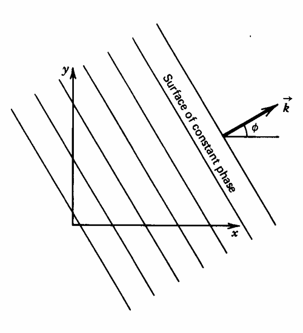
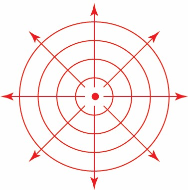

# Derivation of the Wave Equation

## Notation

The instantaneous density is defined as $\rho=\rho(\mathbf r, t)$. For a given medium, the density may vary or fluctuate across position and time. Though there may be small fluctuations present, $\rho$ will generally vary across a steady, averaged value in the medium called the equilibrium ambient density $\rho_0=\rho_0(\mathbf r)$. The equilibrium ambient density may be a function of position (e.g., density of air varies as height above sea level increases), but is not time-dependent. We may define condensation as the density difference relative to $\rho_0$. Mathematically, this is defined as

$$
s=\frac {\rho(\mathbf r, t)-\rho_0(\mathbf r)}{\rho_0(\mathbf r)}
$$ {#eq-condensation}

In a similar vein to density, we may define instantaneous and ambient equilibrium pressures as $\mathcal P=\mathcal P(\mathbf r, t)$ and $\mathcal P_0=\mathcal P_0(\mathbf r)$ respectively. The degree of pressure fluctuation between the instantaneous pressure and equilibrium pressure is the acoustic (or sound) pressure.

$$
p(\mathbf r, t)=\mathcal P(\mathbf r, t)-\mathcal P_0(\mathbf r)
$$ {#eq-acoustic-pressure}

Lastly, temperature is denoted by $T_K$. The subscript $K$ signifies the units must be in Kelvin. In acoustics, we generally do not consider significant timescales where the temperature changes drastically or instantly. Therefore, we make no distinction between instantaneous and equilibrium ambient temperature.

## The Lossless Acoustic Wave Equation

We apply three principles when deriving the lossless wave equation. The term "lossless" in this case refers to the lack of viscous effects in the fluid that the wave is propagating through.

1. Newton's 2^nd^ Law

2. Conservation of Mass (Continuity)

3. Medium Equation of State

### Newton's 2^nd^ Law

For small perturbations, where $|p|\ll\mathcal P_0$, we have the following relation called the *linearized Euler equation*. The derivation comes from a simplification of the Navier-Stokes equation. The derivation will not be given here.

$$
\frac {\partial\mathbf u}{\partial t}+\frac 1{\rho_0}\nabla\mathbf p=\mathbf 0
$$ {#eq-linearized-euler-equation}

where $\nabla\mathbf p$ is the gradient of the acoustic pressure.

### Conservation of Mass

Since mass is always conserved in an acoustic field, we also have the *continuity equation*.

$$
\frac {\partial\rho}{\partial t}+\rho_0\nabla\cdot\mathbf u=0
$$ {#eq-continuity-equation}

### Equation of State

For a thermally perfect gas, we have the following state relation.

$$
\mathcal P=\rho RT_K
$$ {#eq-tpg-equation-state}

There is also an *adiabatic state equation* related to the adiabatic process $p\propto \rho^{\gamma}$ where $\gamma$ is the specific heat ratio. For diatomic gases and air, $\gamma=1.4$.

$$
\frac {\mathcal P}{\mathcal P_0}=\left(\frac {\rho}{\rho_0}\right)^{\gamma}
$$ {#eq-adiabatic-equation-state}

In general, we may apply a 1^st^ order Taylor series approximation to $\mathcal P(\rho)$ centered on $\mathcal P_0=\mathcal P(\rho_0)$ to get

$$
p=\mathcal P(\rho)-\mathcal P(\rho_0)\approx\left.\frac {\partial\mathcal P}{\partial\rho}\right|_{\rho_0}(\rho-\rho_0)=\left.\frac {\partial\mathcal P}{\partial\rho}\right|_{\rho_0}\rho_0s
$$

where $s$ is the condensation, defined above. Define the coefficient of $s$ as the *adiabatic bulk modulus*

$$
\mathcal B=\rho_0\left.\frac {\partial\mathcal P}{\partial\rho}\right|_{\rho_0}
$$ {#eq-adiabatic-bulk-modulus}

::: {.callout-tip title="Physical Interpretation of $\mathcal B$"}

The adiabatic bulk modulus can be thought of as the volumetric stiffness of the fluid.

:::

Therefore, the acoustic pressure is simply

$$
p=\mathcal Bs=\mathcal B\frac {\rho-\rho_0}{\rho_0}
$$ {#eq-acoustic-pressure-definition}

### Derivation from Conservation Laws

From @eq-acoustic-pressure-definition, we may differentiate with respect to time to get $\frac {\partial p}{\partial t}=\mathcal B\frac {\partial s}{\partial t}$. Additionally, from the definition of $s$, we also have $\frac {\partial s}{\partial t}=\rho_0\frac {\partial\rho}{\partial t}$. Assembling everything together gives

$$
\frac 1{\mathcal B}\frac {\partial p}{\partial t}+\nabla\cdot\mathbf u=0
$$

Next, we may eliminiate the $\nabla\cdot\mathbf u$ by taking the divergence of @eq-linearized-euler-equation and substituting the $\nabla\cdot\mathbf u$ above to get

$$
-\frac 1{\mathcal B}\frac {\partial^2\rho}{\partial t^2}+\frac 1{\rho_0}\nabla^2p=0
$$

Further simplification by relating $\mathcal B$ with the speed of sound, $c=\sqrt{\mathcal B/\rho_0}$, gives the *3D classical acoustic wave*.

$$
\boxed{\nabla^2p=\frac 1{c^2}\frac {\partial^2\rho}{\partial t^2}}
$$ {#eq-classical-wave-equation}

### Speed of Sound Relations

We have the following relation for speed of sound from its thermodynamic definition.

$$
\boxed{c=\sqrt{\frac {\gamma\mathcal P_0}{\rho_0}}=\sqrt{\gamma RT_K}}
$$ {#eq-speed-of-sound}

where $\mathcal P_0$ and $\rho_0$ are the ambient pressure and density respectively. To prove @eq-speed-of-sound, differentiate @eq-tpg-equation-state with respect to $\rho$ and substitute into $c=\sqrt{\left.\frac {\partial\mathcal P}{\partial\rho}\right|_{\mathrm{ad}}}$.

::: {.callout-tip title="Factors Affecting $c$"}

The relation derived above in @eq-speed-of-sound is only valid for gases that obey @eq-tpg-equation-state. For other substances like solids or liquids, @eq-speed-of-sound cannot be used. Generally, $c$ is measured and used to relate to other quantities. In general though, $c$ depends on $T_K$ and composition ($c$ in freshwater is different than that in saltwater).

:::

# Traveling Wave Solutions

## Helmholtz Equation

From @eq-classical-wave-equation, we assume that the wave is *harmonic* so $p(\mathbf r,t)$ is a sinuisoidal function with respect to time. This allows us to relate the pressure as

$$
\underline p(\mathbf r,t)=\underline{\underline p}(\mathbf r)e^{j\omega t}
$$ {#eq-complex-pressure-definition}

Note that the coefficient $\underline{\underline p}$ is double-underlined to signify that it refers to the *amplitude* of the complex-valued pressure function $\underline p$. Substituting @eq-complex-pressure-definition into @eq-classical-wave-equation gives the Helmholtz equation.

$$
\nabla^2\underline{\underline p}+k^2\underline{\underline p}(\mathbf r)=0
$$ {#eq-helmholtz-equation}

where $k=\frac {\omega}c$ is called the acoustic wavenumber with units of $\mathrm L^{-1}$.

## Harmonic Plane Waves

For a plane wave, we make the simplification that the wave only propagates in the $x$ direction. Therefore

$$
\underline{\underline p}(\mathbf r)=\underline{\underline p}(x, y, z)=\underline{\underline p}(x)
$$

Moreover, since $\underline{\underline p}$ no longer depends on $y$ and $z$, then $\nabla^2\underline{\underline p}$ reduces to the second derivative of $\underline{\underline p}$. Therefore, @eq-helmholtz-equation reduces down to an ODE.

$$
\frac {\partial^2\underline{\underline p}}{\partial x^2}+k^2\underline{\underline p}=0
$$ {#eq-plane-wave-ode}

The solution to @eq-plane-wave-ode is given by $\underline{\underline p}(x)=\underline A\exp(-jkx)+\underline B\exp(jkx)$. Therefore @eq-complex-pressure-definition for a *harmonic plane wave* becomes

$$
\boxed{\underline p(x, t)=\underline Ae^{j(\omega t-kx)}+\underline Be^{j(\omega t+kx)}}
$$ {#eq-plane-wave-pressure}

The first term, $\underline A\exp[j(\omega t-kx)]$ represents a wave propagating in the $+x$ direction. Similarly, the second term, $\underline B\exp[j(\omega t+kx)]$ represents a wave propagating in the $-x$ direction.

### Particle Velocity

Before proceeding, we should explicitly cover the distinction between two velocity quantities for any given acoustic wave problem. The speed of sound, denoted by $c$, is the velocity at which a pressure disturbance (or acoustic wave) will propagate through a medium.

The particle velocity, denoted by $\mathbf u$, indicates how quickly an individual particle oscillates in an acoustic wave. If the wave is harmonic, then $\mathbf u$ will also be harmonic. Therefore, each particle will sinusoidally oscillate by a very small amount. For the case of a harmonic plane wave, each particle will oscillate in the $x$ direction by $u=|\mathbf u|$ amount.

::: {.callout-note title="Sonic Velocity vs. Particle Velocity in Air"}

For air at standard pressure and temperature, $c\simeq340$ $\mathrm{m/s}$. However, $u$ is generally on the order of magnitude of $1-10^6$ $\mathrm{\mu m/s}$. Broadly speaking, $u\ll c$ and is multiple orders of magnitude smaller.

:::

To compute the particle velocity, we solve the linearized Euler equation, @eq-linearized-euler-equation, for $\underline{\mathbf u}$. In the case of a 1D harmonic plane wave, then $\underline{\mathbf u}=\underline u\hat x$ and $\nabla\underline p=\frac {\partial\underline p}{\partial x}\hat x$. Therefore, @eq-linearized-euler-equation becomes

$$
\frac {\partial u}{\partial t}=-\frac 1{\rho_0}\frac {\partial p}{\partial x}
$$

Next, we must make an assumptions about the wave itself. Assume the propagation direction is specified and is in the $x$ direction with amplitude $\underline A$. The complete expression in @eq-plane-wave-pressure now reduces down to $\underline p(x, t)=\underline A\exp\left[j(\omega t-kx)\right]$. Furthermore, since the wave is harmonic, we know that the particle velocity vector must also be harmonic. Assume that the particle velocity in the $x$-direction is given by

$$
\underline u=\underline Ue^{j(\omega t-kx)}
$$ {#eq-particle-velocity}

Substitute this form into the simplified Euler equation above and solve for the amplitude $\underline U$.

$$
\underline U=\frac {\underline A}{\rho_0c}
$$ {#eq-plane-wave-particle-velocity-magnitude}

This is the magnitude of the particle velocity. We may then derive the complete particle velocity vector for a harmonic plane wave as

$$
\boxed{\underline{\mathbf u}=\underline u_{\pm}(x, t)\hat x=\pm\frac {\underline p(x, t)}{\rho_0c}\hat x}
$$ {#eq-plane-wave-particle-velocity}

The $\pm$ notation indicates the direction of wave propagation. If the wave is propagating in the $-x$ direction, we would take the negative branch of @eq-plane-wave-particle-velocity to obtain that wave's particle velocity vector.

::: {.callout-important title="Particle Velocity of a Superposition of Waves"}

If we assume a harmonic wave is comprised of two independent harmonic plane waves traveling in opposite directions, then the governing pressure equation is

$$
\underline p(x, t)=\underline Ae^{j(\omega t-kx)}+\underline Be^{j(\omega t+kx)}\equiv\underline p_+(x, t)+\underline p_-(x, t)
$$

The particle velocity for this is then

$$
\underline u(x, t)=\frac {\underline p_+(x, t)}{\rho_0c}-\frac {\underline p_-(x, t)}{\rho_0c}=\frac {\underline Ae^{j(\omega t-kx)}}{\rho_0c}-\frac {\underline Be^{j(\omega t+kx)}}{\rho_0c}
$$

Note that $\underline u(x, t)\neq\frac {\underline p(x, t)}{\rho_0c}$. For waves comprised of multiple waves, the particle velocity must be derived by summing up the particle velocities *for each individual wave*.

:::

The expression for $\underline{\mathbf u}$ in @eq-plane-wave-particle-velocity is noticeably complex. To determine the real particle velocity that would be physically observed, take the real part of @eq-plane-wave-particle-velocity.

$$
\boxed{\mathbf u=\pm\frac {\left|A\right|}{\rho_0c}\cos(\omega t-kx+\theta_A)\hat x}
$$ {#eq-plane-wave-real-particle-velocity}

In most cases, we are more interested in the amplitude of the particle oscillation, rather than the full periodic motion. That is not to say the phase angle of @eq-plane-wave-real-particle-velocity is unimportant. Therefore, take the magnitude of @eq-plane-wave-real-particle-velocity to determine the *particle speed*. For a plane wave, the physical particle velocity in the $x$-direction is

$$
u(x)=\frac {\left|A\right|}{\rho_0c}
$$

### Particle Displacement

Since $\bm{\xi}=\frac {\mathrm d\mathbf u}{\mathrm dt}$, we may integrate with respect to time and assume the starting point is the origin. For the case of a harmonic plane wave propagating in the $x$ direction, only $\xi_x$ will be nonzero.

$$
\bm{\xi}=\frac {\underline p(x, t)}{j\rho_0c\omega}\hat x
$$ {#eq-plane-wave-particle-displacement}

### Phase Angle

The complex amplitude, $\underline A$ for a wave propagating in the $x$ direction in @eq-plane-wave-pressure, can be decomposed into a magnitude term and phase angle term.

$$
\underline A=\left|\underline A\right|e^{j\theta_A}
$$

The phase angle accounts for any offset in the wave. The complex pressure in @eq-plane-wave-pressure now becomes

$$
\underline p(x, t)=\left|\underline A\right|e^{j(\omega t-kx+\theta_A)}
$$ {#eq-plane-wave-pressure-with-phase}

The real pressure that is physically observed is simply the real part of @eq-plane-wave-pressure-with-phase.

$$
p(x, t)=\mathrm{Re}\left[\underline p(x, t)\right]=\left|\underline A\right|\cos(\omega t-kx+\theta_A)
$$ {#eq-plane-wave-real-pressure}

::: {.callout-important title="Angular Frequency and Wavenumber are Analogous"}

The real pressure in a plane wave, @eq-plane-wave-real-pressure, also reveals the role $\omega$ and $k$ play in constructing the acoustic field. The term $\omega$ is the angular frequency and has units of $\mathrm{rad/s}$. It is related to the wave's frequency by

$$
f=\frac {\omega}{2\pi}
$$ {#eq-frequency}

where $f$ has units of $\mathrm{Hz}$. The wave's frequency represents the number of wave cycles repeated per second. The frequency is directly used to calculate the *temporal* period of the wave, which is the length of time each wave cycle takes.

$$
T=\frac 1f=\frac {2\pi}{\omega}
$$ {#eq-temporal-period}

Note that the period here describes a period in time. There is also a *spatial* period, called the wavelength, $\lambda$. This is the physical distance the wave covers before it repeats itself.

$$
\lambda=\frac {2\pi}k
$$ {#eq-wavelength}

The $k$ in @eq-wavelength is the *wavenumber* and is the spatial analog of the angular frequency. The units of $k$ are $\mathrm{rad/m}$, similar to how $\omega$ has units of $\mathrm{rad/s}$.

$$
k=\frac {\omega}c
$$ {#eq-wavenumber}

We may relate the wavelength to the period directly by substituting @eq-wavenumber into @eq-wavelength and using @eq-frequency.

$$
\lambda=cT=\frac cf
$$ {#eq-wavelength-wavenumber}

:::

### Propagation in Arbitrary Direction

The previous examples assumed the wave propagated in the same direction as the abscissa. For cases where the wave propagates in an arbitrary direction with respect to the $x$ axis, our quantities for $k$ and $x$ now become a vector. Without loss of generality, assume the wave propagates at an angle $\theta$ with respect to the $x$ axis. Now, the equation for the pressure field becomes the dot product of the wavenumber vector and position vector.

$$
\underline p(\mathbf r, t)=\underline Ae^{j(\omega t-\mathbf k\cdot\mathbf r)}
$$ {#eq-plane-wave-pressure-angled}

The position vector is defined as $\mathbf r=x\hat x+y\hat y+z\hat z$. The wavenumber vector is defined similarly as

$$
\mathbf k=k_x\hat x+k_y\hat y+k_z\hat z
$$

We have, by the magnitude, that $\lVert\mathbf k\rVert^2=k_x^2+k_y^2+k_z^2$. Each component of $\mathbf k$ can be computed based off the overall magnitude $\lVert\mathbf k\rVert=\frac {\omega}c$. For instance, in the 2D case, we have

$$
\begin{aligned}
k_x & =\lVert\mathbf k\rVert\cos\theta=\frac {\omega}c\cos\theta \\
k_y & =\lVert\mathbf k\rVert\sin\theta=\frac {\omega}c\sin\theta
\end{aligned}
$$

::: {.callout-note title="Graphical Proof of Plane Wave Equation"}

A natural question to ask is how the pressure field in @eq-plane-wave-pressure-angled describes a plane wave propagating through space. Inspecting the form of @eq-plane-wave-pressure-angled, for a given amplitude $\left|\underline A\right|$, the pressure is constant when the exponential is constant. Rewriting $\underline A$ in polar form, we have

$$
\underline p(\mathbb r, t)=\left|\underline A\right|e^{j(\omega t-\mathbf k\cdot\mathbf r+\theta_A)}=\left|\underline A\right|e^{j\phi}
$$

where $\phi$ is the *phase*. When $\phi$ is constant, then the pressure is constant. If we assume a 2D wave propagating in the $xy$ plane, then $\phi$ can be written as

$$
y=-\frac {k_x}{k_y}x-\frac {C-\omega t-\theta_A}{k_y}
$$

The last term is constant along a line of constant $\phi$. This describes a series of lines with slope $-\frac {k_x}{k_y}$ that is perpendicular to $\mathbf k$. Since these lines (surfaces in 3D) of constant pressure are perpendicular to the propagation direction, the wave structure described is a plane wave.

{.lightbox width=30%}

:::

## Harmonic Spherical Waves

The other type of wave that can be created is the spherical wave. Unlike a plane wave, spherical waves propagate in all directions simultaneously from a point source. With these wave types, the surface of constant pressure becomes a sphere in 3D or circle in 2D centered on the source.

{.lightbox width=25%}

To derive $\underline p(\mathbf r, t)$, we must solve @eq-helmholtz-equation in spherical coordinates. Recall that in spherical coordinates, we have $(x, y, z)\mapsto(r, \theta, \varphi)$ where $r$ is the distance to the origin, $\theta$ is the azimuth angle, and $\varphi$ is the zenith angle with respect to the $z$ axis. However, by symmetry, we may drop the dependence of $\underline p(\mathbf r, t)$ on $\theta$ and $\varphi$, leaving $\underline p=\underline p(r, t)$. The Laplacian in spherical coordinates with $\theta$ and $\varphi$ dependence eliminated is

$$
\nabla^2\underline p=\frac {\partial^2\underline p}{\partial r^2}+\frac 2r\frac {\partial\underline p}{\partial r}=\frac 1r\frac {\partial^2}{\partial r^2}\left[r\underline p(r, t)\right]
$$

Expanding the Laplacian in @eq-helmholtz-equation, we get

$$
\frac 1r\frac {\partial^2}{\partial r^2}\left[r\underline p(r, t)\right]+k^2\underline p(r, t)=0
$$

We may assume a harmonic spherical wave of the form $\underline p(r, t)=\underline{\underline p}(r)e^{j\omega t}$. Substituting, we may eliminate the exponential, leaving behind

$$
\frac {\partial^2}{\partial r^2}\left[r\underline{\underline p}(r)\right]+k^2r\underline{\underline p}(r)=0
$$

This is identical to the ODE derived for the plane wave but transformed with $r\underline{\underline p}(r)$ instead. Therefore, we may re-use the solution @eq-plane-wave-pressure with $r\underline{\underline p}$ instead. Normalizing both sides by $r$ to isolate $\underline{\underline p}$ gives

$$
\underline{\underline p}(r)=\frac {\underline A}re^{-jkx}+\frac {\underline B}re^{jkx}
$$ {#eq-spherical-wave-pressure}

The first term represents a spherical wave propagating outwards radially and the second represents one propagating in the opposite direction towards the source. Spherical waves that propagate away from the source are called *diverging waves* whereas those that propagate inwards are called *converging waves*. Depending on the boundary conditions, $\underline A=0$ or $\underline B=0$ to recover a single spherical wave propagating inwards or outwards in @eq-spherical-wave-pressure.

Let's assume the wave under consideration is a diverging wave. Expressing $\underline A$ in polar form, the acoustic pressure that is physically observed is

$$
p(r, t)=\frac {\left|\underline A\right|}re^{j(\omega t-kr+\theta_A)}
$$ {#eq-spherical-wave-real-pressure}

::: {.callout-note title="Acoustic Pressure Amplitude of Spherical Waves"}

Note that the pressure term in @eq-spherical-wave-real-pressure is $\propto\frac 1r$. As the wave travels farther and farther away from its source, $r$ increases resulting in $p(r, t)$ decreasing. The cause of this is the increase in surface area of the imaginary sphere encompassing the wave. Since the surface area increases and energy is conserved, the wave amplitude must therefore decrease. This phenomenon is called *spherical spreading* and exists despite ignoring viscous effects. That is, the pressure amplitude decrease is not due to energy dissipation as the governing equation in @eq-helmholtz-equation is lossless.

Spherical spreading generally dominates in most cases, especially "near" the source. Sound may not sound very loud close by due to energy conservation spreading across the increased surface area as the wave propagates from its source. Energy dissipation plays a minor to almost-negligible role in this.

:::

### Particle Velocity

Since we assume the spherical wave is harmonic, then @eq-linearized-euler-equation becomes

$$
\frac {\partial\underline{\mathbf u}}{\partial t}+\frac 1{\rho_0}\nabla\underline p=j\omega\underline{\mathbf u}+\frac {\partial\underline p}{\partial r}\hat r=0
$$

From this, we can see that the particle velocity $\underline{\mathbf u}$ only has a $\hat r$ direction. The pressure derivative term can be evaluated by differentiating @eq-spherical-wave-pressure with respect to $r$. For a diverging wave, $\underline B=0$.

$$
\frac {\partial\underline p}{\partial t}=\frac {\underline A}re^{j(\omega t-kr)}\left(-\frac 1r-jk\right)
$$

Substituting and solving for $\underline{\mathbf u}$, then

$$
\boxed{\underline{\mathbf u}=\left(1-\frac j{kr}\right)\frac {\underline p(r, t)}{\rho_0c}\hat r}
$$ {#eq-spherical-wave-particle-velocity}

### Particle Displacement

Like @eq-plane-wave-particle-displacement, integrate @eq-spherical-wave-particle-velocity with respect to time.

$$
\boxed{\bm{\underline \xi}=\left(1-\frac j{kr}\right)\frac {\underline p(r, t)}{j\rho_0c\omega}\hat r}
$$ {#eq-spherical-wave-particle-displacement}

## Specific Acoustic Impedance

Like mechanical impedance, which is defined as the ratio between a force and velocity quantity, specific acoustic impedance describes the level of resistance that occurs when an acoustic pressure is applied to an arbitrary system.

$$
\underline z=\frac {\underline p}{\underline{\mathbf u}\cdot\hat n_{\mathrm{in}}}
$$ {#eq-specific-acoustic-impedance}

where $\underline{\mathbf u}$ is the particle velocity vector and $\hat n_{\mathrm{in}}$ is the unit vecotr in the direction of wave propagation. For a plane wave, $\hat n_{\mathrm{in}}=\hat x$ so

$$
\boxed{\underline z=\rho_0c\equiv z_0}
$$ {#eq-plane-wave-specific-acoustic-impedance}

The term $z_0$ can be calculated from the fluid's ambient density and speed of sound, two intrinsic properties to the fluid. Since this property is a function of two fluid properties, $z_0$ is *also* a property of a fluid. We call $z_0$ the *characteristic impedance*.

For a spherical wave, $\hat n_{\mathrm{in}}=\hat r$ so $\underline z$ becomes

$$
\boxed{\underline z=\frac {\rho_0c}{1-\frac j{kr}}}
$$ {#eq-spherical-wave-specific-acoustic-impedance}

From @eq-spherical-wave-specific-acoustic-impedance, we can see that $\underline z\neq z_0$ clearly as $\underline z=\underline z(kr)$. But if $kr\gg1$, then $\underline z\to z_0$ for spherical waves. This condition only occurs if the radial distance $r$ dominates the wavenumber and is therefore, only valid in the farfield. From @eq-wavelength, we may rewrite this condition to be in terms of $\lambda$, which is a more-easily recognized property of the wave.

$$
r\gg\frac {\lambda}{2\pi}
$$

# Derived Acoustic Quantities

## Acoustic Intensity

The instantaneous acoustic intensity is related to the flow of power per unit area in the wave. It is defined as

$$
\mathbf I_i(t)=p(t)\mathbf u(t)
$$ {#eq-instantaneous-acoustic-intensity}

Both quantities, $p(t)$ and $\mathbf u(t)$, must be *real*. The time-averaged acoustic intensity is determined by averaging $\mathbf I_i(t)$ across a period, where we assume $T\gg\frac {2\pi}{\omega}$.

$$
\mathbf I(t)=\frac 1T\int_0^T\mathbf I_i(t)\,\mathrm dt
$$ {#eq-time-average-acoustic-intensity}

### Plane Wave

We have the following for $p(x, t)$ and $\mathbf u(x, t)$ for harmonic plane waves.

$$
\begin{aligned}
p(x, t) & =A\cos(\omega t-kx) \\
\mathbf u(x, t) & =\frac A{\rho_0c}\cos(\omega t-kx)\hat x
\end{aligned}
$$

By @eq-instantaneous-acoustic-intensity, we have

$$
\boxed{\mathbf I_i(t)=\frac {A^2}{\rho_0c}\cos^2(\omega t-kx)\hat x}
$$ {#eq-plane-wave-instantaneous-acoustic-intensity}

By the double angle formula, express the $\cos^2(\omega t-kx)$ in terms of $\cos\left[2(\omega t-kx)\right]$. Taking the integral, the cosine term disappears so all we're left with is

$$
\boxed{\mathbf I=\frac {A^2}{2\rho_0c}\hat x}
$$ {#eq-plane-wave-time-average-acoustic-intensity}

### Spherical Wave

The time-average acoustic intensity is

$$
\boxed{\mathbf I=\frac {A^2}{2r^2\rho_0c}}
$$ {#eq-spherical-wave-time-average-acoustic-intensity}

## Effective Pressure

Also known as the root mean square (RMS) pressure, it is determined by taking the square root of the time-average of $p^2(t)$.

$$
P_e=\sqrt{\frac 1T\int_0^Tp^2(t)\,\mathrm dt}
$$ {#eq-effective-pressure}

For a harmonic plane wave, where $p(x, t)=A\cos(\omega t-kx)$, the effective pressure is

$$
\boxed{P_e=\frac {\left|\underline A\right|}{\sqrt 2}}
$$ {#eq-plane-wave-effective-pressure}

Using @eq-plane-wave-time-average-acoustic-intensity, the acoustic intensity is also

$$
\boxed{\mathbf I=\frac {P_e^2}{\rho_0c}\hat x}
$$ {#eq-plane-wave-time-average-acoustic-intensity-pe}

For a spherical wave, $p(r, t)=\frac Ar\cos(\omega t-kr)$ so

$$
\boxed{P_e=\frac {\left|\underline A\right|}{r\sqrt 2}}
$$ {#eq-spherical-wave-effective-pressure}

Using @eq-spherical-wave-time-average-acoustic-intensity, the acoustic intensity is also

$$
\boxed{\mathbf I=\frac {P_e^2(r)}{\rho_0c}\hat r}
$$ {#eq-spherical-wave-time-average-acoustic-intensity-pe}

::: {.callout-tip title="Acoustic Intensity"}

Both formulas for $\mathbf I$ for spherical and plane waves follow the same general form.

$$
\mathbf I=\frac {P_e^2}{\rho_0c}\hat n_{\mathrm{in}}
$$

where $\hat n_{\mathrm{in}}$ is the unit vector in the direction of wave propagation and $P_e$ is the effective pressure. For plane and spherical waves, $\hat n_{\mathrm{in}}=\hat x$ or $\hat r$ and $P_e=\frac A{\sqrt 2}$ or $\frac A{r\sqrt2}$ respectively.

:::

## Power

The total power for an acoustic wave is the integral of @eq-time-average-acoustic-intensity across the entire surface $\mathcal S$.

$$
\Pi=\int\limits_{\mathcal S}\mathbf I\cdot\mathbf n_s\,\mathrm dS
$$ {#eq-power}

### Plane Wave

From @eq-plane-wave-time-average-acoustic-intensity, $\mathbf I$ is constant for a given $x$ position. Therefore, @eq-power becomes

$$
\Pi=\frac {S|\underline A|^2}{2\rho_0c}
$$ {#eq-plane-wave-power}

where $S$ is the cross-sectional area of the plane wave.

### Spherical Wave

From @eq-spherical-wave-time-average-acoustic-intensity-pe, at a given radius $R$ from the source, the radial acoustic intensity is constant since $P_e(R)$ is constant and so is $\rho_0c$. Therefore, we have

$$
\boxed{\Pi(R)=\frac {4\pi R^2}{\rho_0c}P_e^2(R)}
$$ {#eq-spherical-wave-power}

::: {.callout-tip title="Power at Different Positions"}

For spherical waves, recall that the governing form of @eq-helmholtz-equation assumed no dissipation or loss of energy to the surroundings. Additionally, for all space excluding the point source, there is no additional source of energy for the wave. Therefore, by conservation of energy, we must have that $\Pi(R_1)=\Pi(R_2)$ where $R_1<R_2$. This same line of reasoning can be made to deduce that $\Pi(x_1)=\Pi(x_2)$ for plane waves, where $x_1<x_2$.

:::

## Acoustic Energy Density

Defined as the instantaneous energy per unit volume, the acoustic energy density may be calculated by summing both the kinetic and potential energy of the wave.

$$
\varepsilon_i(t)=\frac 12\rho_0u^2(t)+\frac 12\left(\frac {p(t)}{\rho_0c}\right)^2
$$ {#eq-acoustic-energy-density}

The total energy $E(t)$ is determined by integrating $\varepsilon_i(t)$ across the entire volume $\mathcal V$.

$$
E(t)=\int\limits_{\mathcal V}\varepsilon_i(t)\,\mathrm dV
$$ {#eq-acoustic-energy}

Both $u(t)$ and $p(t)$ must be the real quantities in @eq-acoustic-energy-density. Similar to @eq-time-average-acoustic-intensity, we may define a time-averaged energy density as

$$
\varepsilon=\frac 1T\int_0^T\varepsilon_i(t)\,\mathrm dt
$$ {#eq-time-average-energy-density}

### Plane Wave

For a plane wave, we have from @eq-time-average-energy-density

$$
\varepsilon=\frac {P_e^2(x)}{\rho_0c^2}
$$ {#eq-plane-wave-time-average-energy-density}

### Spherical Wave

For a spherical wave, we have from @eq-time-average-energy-density

$$
\varepsilon=\frac {P_e^2(r)}{\rho_0c^2}\left(1+\frac 1{2k^2r^2}\right)
$$ {#eq-spherical-wave-time-average-energy-density}

## The Decibel Scale

Humans can perceive sounds ranging from acoustic pressures of $20$ $\mathrm{\mu Pa}$ to $2$ $\mathrm{Pa}$. This is a $10^5$ order of magnitude difference. Moreover, since energy is proportional to $P_e^2$, this range drastically increases from an energy perspective. We introduce a logarithmic scale to accommodate the large range in acoustic pressures.

### Sound Intensity Level

The most widely used logarithmic scale for describing sound level is the decibel scale. The intensity level of an acoustic intensity $\mathbf I$ is defined by

$$
\mathrm{IL}=10\log_{10}\left(\frac {\lVert\mathbf I\rVert}{I_{\mathrm{ref}}}\right)
$$ {#eq-intensity-level}

The reference intensity, $I_{\mathrm{ref}}$, is defined as the acoustic intensity at the lowest sound intensity perceivable by humans. Generally, $I_{\mathrm{ref}}=10^{-12}$ $\mathrm{W/m^2}$.

### Sound Pressure Level

The sound pressure level is similar in form to @eq-intensity-level.

$$
\mathrm{SPL}=20\log_{10}\left(\frac {P_e}{P_{\mathrm{ref}}}\right)
$$ {#eq-pressure-level}

The reference pressure is usually taken to be $20$ $\mu\mathrm{Pa}$. This value is somewhat arbitrary, but was deemed reference as it is the hearing threshold for a $1$ $\mathrm{kHz}$ acoustic wave. By the properties of logarithm, every time the sound pressure is increased by a factor of $10$, $20$ $\mathrm{dB}$ is added to $\mathrm{SPL}$.

::: {.callout-tip title="Human Hearing Range"}

Humans can generally hear from $0$ $\mathrm{dB}$ to $100$ $\mathrm{dB}$.

:::

::: {.callout-note title="Example: Peak-to-Peak Displacement" collapse=true}

**Problem:** Compute the peak-to-peak displacement of a plane wave with $\mathrm{SPL}=100$ $\mathrm{dB}$ at $500$ $\mathrm{kHz}$.

*Solution:* From @eq-pressure-level, solve for $P_e$.

$$
P_e=P_{\mathrm{ref}}\cdot 10^5=2\times10^{-5}\times10^5=2\space\mathrm{Pa}
$$

Relate the effective pressure to the acoustic pressure using @eq-plane-wave-effective-pressure. Note that $\underline A$ in this case represents the pressure amplitude.

$$
\underline A=P_e\sqrt2
$$

Next, compute the particle velocity vector $\underline{\mathbf u}$ using

$$
\underline{\mathbf u}=\frac {\underline A}{\rho_0c}\hat x=\frac {P_e\sqrt2}{\rho_0c}\hat x
$$

The magnitude of $\underline{\mathbf u}$ is simply $\frac {P_e\sqrt2}{\rho_0c}$. To relate to peak-to-peak displacement, make use that $\bm{\xi}$ is harmonic.

$$
\underline{\mathbf u}=\frac {\mathrm d\underline{\bm{\xi}}}{\mathrm dt}=j\omega\underline{\bm{\xi}}
$$

Take the magnitude of both sides and the $j$ disappears.

$$
\left|\underline{\bm{\xi}}\right|=\frac {P_e\sqrt2}{\rho_0\omega c}=\frac {P_e\sqrt2}{2\pi\rho_0fc}
$$

The frequency is known. We assume the sound wave is propagating through air, so $\rho_0=1.184$ $\mathrm{kg/m^3}$ and $c=344$ $\mathrm{m/s}$.

:::