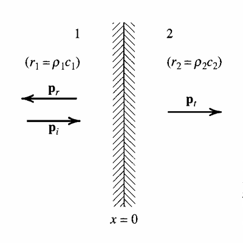
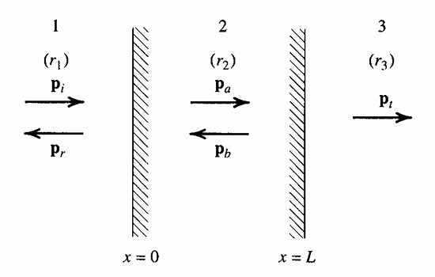
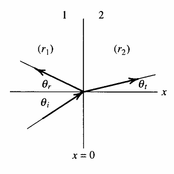

# Fluid-Fluid Boundaries

## Normal Incidence

Consider the case where an incident plane wave with pressure $p_i$ colliding with a fluid-fluid boundary. The fluids have different characteristic impedances. That is, $z_{0,1}\neq z_{0,2}$.

{.lightbox width=30%}

Part of the wave is transmitted through the boundary into medium $2$. We denote this wave with $p_t$ to signify that it is transmitted through the boundary. Another part of the incident wave is reflected by the boundary back into medium $1$. Let $p_r$ denote the reflected wave. The goal is to determine how much of $p_i$ is transmitted vs. reflected.

Define the *pressure reflection coefficient* as the ratio between the reflected wave's pressure to that of the incident wave's. We may define an identical quantity for the transmitted pressure, called the *pressure transmission coefficient*.

$$
\begin{aligned}
\underline T & =\frac {\underline{\underline p}_t}{\underline{\underline p}_i} \\
\underline R & =\frac {\underline{\underline p}_r}{\underline{\underline p}_i}
\end{aligned}
$$ {#eq-pressure-coefficients}

These two quantities are currently unknown, so we need a total of $2$ equations. These two equations come from conservation laws. We have that at the boundary, the net force from the incident wave "colliding" with the boundary should be zero to prevent the boundary from moving (the boundary does not accelerate nor move with constant velocity). Therefore, pressure must be continuous across the boundary.

$$
p_1(0, t)=p_2(0, t)
$$ {#eq-fluid-fluid-normal-pressure-constraint}

The second constraint is that the particle velocities must be equal on both sides as energy is transferred across the boundary, but mass is not.

$$
\underline{\mathbf u}_1=\underline{\mathbf u}_2
$$ {#eq-fluid-fluid-normal-particle-velocity-constraint}

### Pressure Continuity Constraint

We may express $\underline p_i$, $\underline p_t$, and $\underline p_r$ using their harmonic plane wave definitions.

$$
\begin{aligned}
\underline p_i(x, t) & =\underline{\underline p}_i e^{j(\omega t-k_1x)} \\
\underline p_t(x, t) & =\underline{\underline p}_t e^{j(\omega t-k_2x)} \\
\underline p_r(x, t) & =\underline{\underline p}_r e^{j(\omega t+k_1x)}
\end{aligned}
$$ {#eq-plane-wave-pressures}

The pressure in medium $1$ is the sum of $\underline p_i$ and $\underline p_r$. And the pressure in medium $2$ is simply $\underline p_t$. Therefore, @eq-fluid-fluid-normal-pressure-constraint becomes

$$
\underline{\underline p}_i+\underline{\underline p}_r=\underline{\underline p}_t
$$

Normalize both sides by $\underline{\underline p}_t$ to recover $\underline T$ and $\underline R$.

$$
\boxed{1+\underline R=\underline T}
$$ {#eq-fluid-fluid-normal-pressure-coefficient-relation}

### Particle Velocity Constraint

From the equation of $\underline{\mathbf u}$ for a plane wave, we have the following

$$
\begin{aligned}
\underline u_i(x, t) & =\frac {\underline{\underline p}_i(x, t)}{\rho_1c_1}e^{j(\omega t-k_1x)} \\
\underline u_t(x, t) & =\frac {\underline{\underline p}_t(x, t)}{\rho_2c_2}e^{j(\omega t-k_2x)} \\
\underline u_r(x, t) & =-\frac {\underline{\underline p}_r(x, t)}{\rho_1c_1}e^{j(\omega t+k_1x)}
\end{aligned}
$$ {#eq-plane-wave-particle-velocities}

The particle velocity in fluid $1$ is the sum of the incident and reflected particle velocities. And the particle velocity in fluid $2$ is simply that of the transmitted wave's. Therefore, @eq-fluid-fluid-normal-particle-velocity-constraint becomes

$$
\frac {\underline{\underline p}_i-\underline{\underline p}_r}{\rho_1c_1}=\frac {\underline{\underline p}_t}{\rho_2c_2}
$$

Dividing both sides by $\underline{\underline p}_i$, we get

$$
\frac {1-\underline R}{z_1}=\frac {\underline T}{z_2}
$$ {#eq-fluid-fluid-normal-particle-velocity-relation}

### Transmission and Reflection Coefficients

With @eq-fluid-fluid-normal-pressure-coefficient-relation and @eq-fluid-fluid-normal-particle-velocity-relation, solving for $\underline T$ and $\underline R$ gives

$$
\begin{aligned}
&\boxed{
\mathrlap{\underline{T}=\frac{2z_2}{z_1+z_2}=\frac{2z_2/z_1}{1+z_2/z_1}}
\phantom{\underline{R}=\frac{z_2-z_1}{z_1+z_2}=\frac{z_2/z_1-1}{1+z_2/z_1}}
}\\[8pt]
&\boxed{
\underline{R}=\frac{z_2-z_1}{z_1+z_2}=\frac{z_2/z_1-1}{1+z_2/z_1}
}
\end{aligned}
$$ {#eq-fluid-fluid-normal-pressure-coefficients}

Let's now investigate specific cases of reflection and transmissions across the boundary.

#### Case 1: $z_1\ll z_2$ {#sec-fluid-fluid-normal-pressure-coefficients-air-water}

An example of $z_1\ll z_2$ is an incident wave propagating from air into water. In @eq-fluid-fluid-normal-pressure-coefficients, we assume $z_2$ contribution is negligible so $\underline T=2$ and $\underline R=1$. Under these conditions, the transmitted pressure is expected to be twice as large as that of the incident wave. And the reflected pressure amplitude is expected to be equal to that of the incident wave.

#### Case 2: $z_1\gg z_2$ {#sec-fluid-fluid-normal-pressure-coefficients-water-air}

For the opposite case, where a wave is propagating from water into air, we assume that the impedance $z_2$ is negligible in @eq-fluid-fluid-normal-pressure-coefficients so $\underline T=\frac {2z_2}{z_1}\ll 1$ and $\underline R=-1$. The transmitted wave amplitude is very small (seemingly negligible), whereas the reflected wave amplitude is equal in magnitude to the incident wave's, but opposite in phase.

### Intensity Transmission and Reflection Coefficients

The time-averaged intensities can be constructed in an identical manner to $\underline T$ and $\underline R$.

$$
\begin{aligned}
T_I & =\frac {I_t}{I_i} \\
R_I & =\frac {I_r}{I_i}
\end{aligned}
$$

From the acoustic intensity formulas for a plane wave, we have

$$
\begin{aligned}
I_i & =\frac {\left|\underline p_i\right|^2}{2z_1} \\
I_t & =\frac {\left|\underline p_t\right|^2}{2z_2} \\
I_r & =\frac {\left|\underline p_r\right|^2}{2z_1}
\end{aligned}
$$ {#eq-plane-wave-intensities}

For the reflection coefficient, the two impedances cancel as they're both $z_1$. The transmission coefficient, on the other hand, includes a $\frac {z_2}{z_1}$ ratio. Simplification gives

$$
\begin{aligned}
&\boxed{
    \mathrlap{R_I=\left|\underline R\right|^2=\left(\frac{z_2-z_1}{z_2+z_1}\right)^2}
    \phantom{T_I=\frac{z_2}{z_1}\left|\underline T\right|^2=\frac{4z_1z_2}{(z_1+z_2)^2}}
}\\[8pt]
&\boxed{
    T_I=\frac{z_2}{z_1}\left|\underline T\right|^2=\frac{4z_1z_2}{(z_1+z_2)^2}
}
\end{aligned}
$$ {#eq-fluid-fluid-normal-intensity-coefficients}

#### Case 1: $z_1\ll z_2$

We consider $z_1$ negligible compared to $z_2$. The intensity transmission coefficient becomes

$$
T_I=\frac {4z_1z_2}{(z_1+z_2)^2}\approx\frac {4z_1}{z_2}\ll1
$$

In @sec-fluid-fluid-normal-pressure-coefficients-air-water, we computed $\underline T\simeq2$ and $\underline R\simeq1$, meaning the transmitted wave's pressure amplitude was doubled while the reflected wave's amplitude remained constant. Despite having a $\underline T=2$, $T_I\ll1$ meaning the acoustic power is very small.

This is a consequence of the high impedance in medium $2$. The impedance scales as $\underline z=\frac {\underline p(x, t)}{\underline{\mathbf u}(x, t)}$. Even though the pressure amplitude is doubled, because of the high impedance, the particle velocity is still very small in medium $2$. As a result, the power transmitted is still very small despite the high pressure.

This type of boundary, where the impedance increases from low to high across the interface, is often referred to as a **hard boundary** or a **rigid wall**.

#### Case 2: $z_1\gg z_2$

We consider $z_2$ to be negligible compared to $z_1$. The intensity transmission coefficient becomes

$$
T_I=\frac {4z_1z_2}{(z_1+z_2)^2}\approx\frac {4z_2}{z_1}\gg1
$$

In @sec-fluid-fluid-normal-pressure-coefficients-water-air, we determined $\underline T\simeq0$ and $\underline R\simeq-1$. Since $\underline T\simeq0$, there is no transmitted wave through medium $2$. Moreover, the reflected wave in medium $1$ has the same pressure amplitude as the incident wave, but is out of phase by $\pi$. The two waves destructively intefere and cancel each other out exactly. The total response in fluid $1$ is a standing wave.

This type of boundary, where the impedance increases from high to low across the boundary, is called a **pressure release boundary** since the acoustic pressure disappears through the interface.

### Power Transmission and Reflection Coefficients

Since there is a relation between $\mathbf I$ and $\Pi$, we may also construct power transmission and reflection coefficients for each wave. If we define $S$ to be the cross-sectional area of the wave, then $\Pi=SI$. From conservation of power, we have

$$
\Pi_i=\Pi_r+\Pi_t
$$

That is, the incident wave carries all the power prior to the exchange. Normalize both sides by $\Pi_i$ to obtain

$$
R_{\Pi}+T_{\Pi}=1
$$ {#eq-fluid-fluid-normal-power-coefficient-relation}

Since $S$ is constant for the incident, transmitted, and reflected waves, we also have the same relation for acoustic intensity. That is

$$
I_i=I_r+I_t
$$ {#eq-fluid-fluid-normal-intensity-coefficient-relation}

Therefore, for normal incidence, the power and intensity coefficients have the same formulas.

$$
\begin{aligned}
&\boxed{
    \mathrlap{T_{\Pi}=T_I=\frac{4z_1z_2}{(z_1+z_2)^2}}
    \phantom{R_{\Pi}=R_I=\left(\frac{z_2-z_1}{z_2+z_1}\right)^2}
}\\[8pt]
&\boxed{
    R_{\Pi}=R_I=\left(\frac{z_2-z_1}{z_2+z_1}\right)^2
}
\end{aligned}
$$ {#eq-fluid-fluid-normal-power-coefficients}

From @eq-fluid-fluid-normal-intensity-coefficient-relation or @eq-fluid-fluid-normal-power-coefficient-relation, since the incident beam carries the entire intensity and power, we have that

$$
\begin{gathered}
0\leq T_I\leq1 \\
0\leq R_I\leq1
\end{gathered}
$$

The same set of restrictions apply for $T_{\Pi}$ and $R_{\Pi}$.

## Normal Incidence on Fluid Layer

Now, we extend the derivation to include a layer of fluid, referred to as medium $2$, that separates media $1$ and $3$ from each other. An incident plane wave propagates through medium $1$ and must travel through two boundaries to reach fluid $3$, as shown in @fig-normal-incidence-fluid-layer.

{#fig-normal-incidence-fluid-layer .lightbox width=30%}

As $\underline p_i$ reaches the boundary between fluid $1$ and $2$, it will separate into a transmitted and reflected wave labeled $\underline p_a$ and $\underline p_r$ respectively in @fig-normal-incidence-fluid-layer. Similarly, as $\underline p_a$ reaches the boundary between fluid $2$ and $3$, it too will be decomposed into a transmitted and reflected component labeled $\underline p_t$ and $\underline p_b$. We assume the fluid layer has length $L$ with the left-side interface positioned at $x=0$.

### Constraints

Like the normal incidence on a fluid boundary, we must ensure continuous pressure and particle velocity across the boundary. That is, the pressure and particle velocities on either side must be equal. These serve as the boundary conditions that allow us to compute $\underline T$, $\underline R$, $T_I$, $R_I$, and so on.

#### Continuity of Pressure

The harmonic pressure equations for the pressures in all three fluids are

$$
\begin{aligned}
\underline p_1(x, t) & =\underline p_i(x, t)+\underline p_r(x, t)=\underline{\underline p}_ie^{j(\omega t-k_1x)}+\underline{\underline p}_re^{j(\omega t+k_2x)} \\
\underline p_2(x, t) & =\underline p_a(x, t)+\underline p_b(x, t)=\underline Ae^{j(\omega t-k_2x)}+\underline Be^{j(\omega t+k_2x)} \\
\underline p_3(x, t) & =\underline p_t(x, t)=\underline{\underline p}_te^{j(\omega t-k_3x)}
\end{aligned}
$$ {#eq-fluid-fluid-normal-layer-pressures}

Since there are two boundaries, we now have two sets of equations for continuity of pressure alone.

$$
\begin{gathered}
\underline{\underline p}_i+\underline{\underline p}_r=\underline A+\underline B \\
\underline Ae^{-jk_2L}+\underline Be^{jk_2L}=\underline{\underline p}_te^{-jk_3L}
\end{gathered}
$$ {#eq-fluid-fluid-normal-layer-continuity-pressure}

#### Continuity of Particle Velocities

Similar to @eq-fluid-fluid-normal-layer-continuity-pressure, we may also write two sets of equations for the particle velocities. From the particle velocity equation for a plane wave, we have

$$
\begin{aligned}
\underline u_1(x, t) & =\underline u_i(x, t)+\underline u_r(x, t)=\frac {\underline{\underline p}_i }{z_1}e^{j(\omega t-k_1x)}-\frac {\underline{\underline p}_r}{z_1}e^{j(\omega t+k_1x)} \\
\underline u_2(x, t) & =\underline u_A(x, t)+\underline u_B(x, t)=\frac {\underline A}{z_1}e^{j(\omega t-k_2x)}-\frac {\underline B}{z_2}e^{j(\omega t+k_2x)} \\
\underline u_3(x, t) & =\frac {\underline p_t(x, t)}{z_3}=\frac {\underline{\underline p}_t}{z_3}e^{j(\omega t-k_3x)}
\end{aligned}
$$ {#eq-fluid-fluid-normal-layer-particle-velocities}

Continuity of particle velocity applied to $x=0$ and $x=L$ interfaces gives

$$
\begin{gathered}
\frac {\underline{\underline p}_i-\underline{\underline p}_r}{z_1}=\frac {\underline A-\underline B}{z_2} \\
\frac {\underline A}{z_2}e^{-jk_2L}-\frac {\underline B}{z_2}e^{jk_2L}=\frac {\underline{\underline p}_t}{z_3}e^{-jk_3L}
\end{gathered}
$$ {#eq-fluid-fluid-normal-layer-continuity-particle-velocities}

### Transmission and Reflection Coefficients

Together, @eq-fluid-fluid-normal-layer-continuity-pressure and @eq-fluid-fluid-normal-layer-continuity-particle-velocities give four equations for four unknowns: $\underline T$, $\underline R$, $\underline A/\underline{\underline p}_i$, and $\underline B/\underline{\underline p}_i$. Solving for $\underline T$ and $\underline R$ gives

$$
\begin{aligned}
&\boxed{
\mathrlap{\underline T=\frac{2}{(1+z_1/z_3)\cos k_2L+j(z_2/z_3+z_1/z_2)\sin k_2L}}
\phantom{\underline R=\frac{(1-z_1/z_3)\cos k_2L+j(z_2/z_3-z_1/z_2)\sin k_2L}{(1+z_1/z_3)\cos k_2L+j(z_2/z_3+z_1/z_2)\sin k_2L}}
}\\[8pt]
&\boxed{
\underline R=\frac{(1-z_1/z_3)\cos k_2L+j(z_2/z_3-z_1/z_2)\sin k_2L}{(1+z_1/z_3)\cos k_2L+j(z_2/z_3+z_1/z_2)\sin k_2L}
}
\end{aligned}
$$ {#eq-fluid-fluid-normal-layer-pressure-coefficients}

The transmitted and reflection coefficients can be related to one another, similar to @eq-fluid-fluid-normal-pressure-coefficient-relation, by expressing continuity of pressure at each interface separately and eliminating $\underline A$ and $\underline B$. The final form is **different** than @eq-fluid-fluid-normal-pressure-coefficient-relation.

$$
\boxed{1+\underline R=\underline T\left(\cos k_2L+j\frac {z_2}{z_3}\sin k_2L\right)}
$$ {#eq-fluid-fluid-normal-layer-pressure-coefficient-relation}

::: {.callout-important title="Continuity of Pressure for Fluid Layer"}

The continuity of pressure relation for a fluid layer is completely different than that of a fluid-fluid boundary. In other words, *do not* directly apply @eq-fluid-fluid-normal-pressure-coefficient-relation to a fluid layer problem as this equation is no longer valid. Use @eq-fluid-fluid-normal-layer-pressure-coefficient-relation instead.

:::

### Intensity Transmission and Reflection Coefficients

By conservation of power across the fluid layer, we still have

$$
\boxed{R_I+T_I=1}
$$ {#eq-fluid-fluid-normal-layer-intensity-coefficient-relation}

This is identical to @eq-fluid-fluid-normal-intensity-coefficient-relation. The same definitions of $R_I=\frac {I_r}{I_i}$ and $T_I=\frac {I_t}{I_i}$ hold here as they did for a fluid-fluid boundary. The reflection and transmission coefficients can be computed by using the equation of $\mathbf I$ for a plane wave. We see that

$$
\begin{aligned}
&\boxed{
T_I=\frac{4}{2+\left(\frac{z_3}{z_1}+\frac{z_1}{z_3}\right)^2\cos^2 k_2L+\left(\frac{z_2^2}{z_1z_3}+\frac{z_1z_3}{z_2^2}\right)\sin^2 k_2L}
}\\[8pt]
&\boxed{
\mathrlap{R_I=\frac{\left(1-\frac{z_1}{z_3}\right)^2\cos^2 k_2L+\left(\frac{z_2}{z_3}-\frac{z_1}{z_2}\right)^2\sin^2 k_2L}{\left(1+\frac{z_1}{z_3}\right)^2\cos^2 k_2L+\left(\frac{z_2}{z_3}+\frac{z_1}{z_2}\right)^2\sin^2 k_2L}}
\phantom{T_I=\frac{4}{2+\left(\frac{z_3}{z_1}+\frac{z_1}{z_3}\right)^2\cos^2 k_2L+\left(\frac{z_2^2}{z_1z_3}+\frac{z_1z_3}{z_2^2}\right)\sin^2 k_2L}}
}
\end{aligned}
$$ {#eq-fluid-fluid-normal-layer-intensity-coefficients}

### Transmission Loss

In acoustics, we often determine the transmission loss across the fluid layer. This is the change in intensity across the fluid layer in the decibel scale. By definition, the transmission loss is

$$
\mathrm{TL}=L_{I_i}-L_{I_t}=10\log_{10}\left(\frac 1{T_I}\right)
$$ {#eq-fluid-fluid-normal-layer-transmission-loss}

where $L_{I_i}$ and $L_{I_t}$ are the intensity levels of the incident and transmitted waves respectively. Since $0\leq T_I\leq1$, we require that $\mathrm{TL}\geq0$.

::: {.callout-important title="Transmission Loss Definition"}

The formula for $\mathrm{TL}$ is only applicable to intensity level. In other words, we generally *do not* have

$$
\mathrm{TL}\neq L_{p_i}-L_{p_t}
$$

:::

### Special Cases

Let's consider __ different cases regarding the fluid layers.

#### Case 1: $z_1=z_3$

Consider the case where there is a fluid layer dividing air on both sides. Since $z_1=z_3$, $T_I$ in @eq-fluid-fluid-normal-layer-intensity-coefficients simplifies to

$$
T_I=\frac 1{1+\frac 14\left(\frac {z_2}{z_1}-\frac {z_1}{z_2}\right)^2\sin^2k_2L}
$$

The transmission loss from @eq-fluid-fluid-normal-layer-transmission-loss is

$$
\mathrm{TL}=10\log_{10}\left[1+\frac 14\left(\frac {z_1}{z_2}-\frac {z_2}{z_1}\right)^2\sin^2k_2L\right]
$$ {#eq-fluid-fluid-normal-layer-air-fluid-air-transmission-loss}

Inspecting @eq-fluid-fluid-normal-layer-air-fluid-air-transmission-loss, $\mathrm{TL}=0$ when $k_2L=n\pi$ where $n\in\mathbb Z^+$. When there is no transmission loss, the fluid layer is said to be *acoustically transparent* and no loss in intensity or power of the incident wave occurs. We can compute the frequency this occurs by solving for $k_2=\frac {\omega}{c_2}$.

$$
f=\frac {\omega}{2\pi}=\frac {nc_2}{2L}
$$

The wavelength is simply $\lambda_n=\frac {c_2}f=\frac {2L}n$ so we see that the $L=\frac {n\lambda_n}2$ for the fluid layer to be acoustically transparent. In other words, $L$ must be a multiple of $\frac {\lambda}2$ of the wave. If we further assume that $z_2\gg z_1$, which is a reasonable approximation for most situations involving liquid or solid layers between gases, we can neglect $\frac {z_1}{z_2}$ in @eq-fluid-fluid-normal-layer-air-fluid-air-transmission-loss.

$$
\mathrm{TL}=10\log_{10}\left[1+\frac 14\left(\frac {z_2}{z_1}\right)^2\sin^2k_2L\right]
$$

For small wavelengths, where $k_2L\ll1$, use the small angle approximation and define the specific density as $\rho_s=\rho_2L$. The specific density is a measure of the density per unit area, as opposed to per unit volume, and has units of $\mathrm{kg/m^2}$. The transmission loss equation becomes @eq-mass-law, called the *Mass Law*.

$$
\boxed{\mathrm{TL}=10\log_{10}\left[1+\left(\frac {\rho_s\omega}{2z_1}\right)^2\right]}
$$ {#eq-mass-law}

When compared to @eq-fluid-fluid-normal-layer-air-fluid-air-transmission-loss, @eq-mass-law is a very good approximation for small $k_2L$. That is, $k_2L\ll\frac {\pi}2$, where the small angle approximation is reasonable.

#### Case 2: $z_1\neq z_3$ and $z_2=\sqrt{z_1z_3}$

For this special case, $z_2$ is the geometric mean of $z_1$ and $z_3$. Substituting into $T_I$ in @eq-fluid-fluid-normal-intensity-coefficients, we simplify to

$$
T_I=\frac 1{1+\frac 14\left(\frac {z_3}{z_1}+\frac {z_1}{z_3}-2\right)\cos^2k_2L}
$$

If $k_2L=\frac {(2n+1)\pi}2$ where $n\in\mathbb Z^+$, then $T_I=1$ and the layer is once again acoustically transparent. Unlike the previous example, this case of acoustic transparency is interesting since it is a direct consequence of the presence of medium $2$. If we remove the layer, then $T_I\neq1$ as there is transmission loss due to the difference in impedances between media $1$ and $3$. But choosing a special material such that $z_2=\sqrt{z_1z_3}$ ensures that $\underline p_t=\underline p_i$ and $\underline p_r=0$.

## Oblique Incidence

The previous incidences have assumed a plane wave traveling in a direction perpendicular to the boundary. Now we investigate how the acoustic field changes when the wave is angled (i.e., oblique).

{#fig-oblique-incident-fluid-boundary .lightbox width=30%}

The incident wave is in the bottom left and forms an angle $\theta_i$ with respect to the horizontal. Since the fluid boundary is vertical along $x=0$, this angle is formed parallel to the boundary normal and is called the incident angle. Like before, the wave is divided into a transmitted portion and reflected portion, each forming their own respective angles with the horizontal. Assume each fluid has an impedance $z_1\neq z_2$. Note that in @fig-oblique-incident-fluid-boundary, $r_1$ and $r_2$ denote impedances. We will stick to our $z_1$ and $z_2$ convention, however.

### Constraints

#### Continuity of Pressure

Therefore, we see that the incident angle and reflected angle must be *identical*.

$$
\boxed{\theta_i=\theta_r}
$$ {#eq-fluid-fluid-oblique-incident-reflected-angle-relation}

Additionally, we may consider the last two expressions to derive *Snell's Law* between the incident and transmitted angles.

$$
\boxed{\frac {\sin\theta_i}{c_1}=\frac {\sin\theta_t}{c_2}}
$$ {#eq-snells-law}

From this, it is clear to see that

$$
\boxed{1+\underline R=\underline T}
$$ {#eq-fluid-fluid-oblique-pressure-coefficient-relation}

#### Continuity of Normal Particle Velocities

Unlike the previous sections, where the total particle velocity must be the same across a boundary, an oblique incident only requires the *normal* particle velocity component be the same. Since particles may slip along the boundary, we have that $u_x$ be equal on both sides for our choice of coordinate system in @fig-oblique-incident-fluid-boundary.

### Transmission and Reflection Coefficients

Solving the system of equations above gives

$$
\begin{aligned}
&\boxed{
\mathrlap{\underline T=\frac{2z_2\sec\theta_t}{z_2\sec\theta_t+z_1\sec\theta_i}}
\phantom{\underline R=\frac{z_2\sec\theta_t-z_1\sec\theta_i}{z_2\sec\theta_t+z_1\sec\theta_i}}
}\\[8pt]
&\boxed{
\underline R=\frac{z_2\sec\theta_t-z_1\sec\theta_i}{z_2\sec\theta_t+z_1\sec\theta_i}
}
\end{aligned}
$$ {#eq-fluid-fluid-oblique-pressure-coefficients}

### Intensity Transmission and Reflection Coefficients

### Special Cases

#### Case 1: $c_1>c_2$

If the sonic velocity in medium $2$ is smaller than that of medium $1$'s, such as the case of a wave propagating from water into air, Snell's Law states

$$
\theta_t=\arcsin\left(\frac {c_2}{c_1}\sin\theta_i\right)
$$

If $c_2<c_1$, we must have that $\theta_t<\theta_i$. The transmitted wave will propagate in a direction closely parallel to the interface normal (i.e., almost horizontal in @fig-oblique-incident-fluid-boundary) as $\theta_t$ will be small.

#### Case 2: $c_1<c_2$

If we reverse the situation, that is consider a wave propagating from air to water, we see that $\theta_t>\theta_i$ from @eq-snells-law and the transmitted wave will propagate almost parallel to the fluid boundary.

From Snell's Law, we can see that there is indeed a limit to the value of $\theta_t$ possible. If $c_2\gg c_1$ such that $\frac {c_2}{c_1}\sin\theta_i>1$, then no real value of $\theta_t$ will satisfy @eq-snells-law.

$$
\sin\theta_t=\frac {c_2}{c_1}\sin\theta_i
$$

Evidently, there wil be a point where $\frac {c_2}{c_1}\sin\theta_i=1$ for a given value of $c_2$ relative to $c_1$. The value of $\theta_i$ at that condition is called the *critical angle* and is often denoted as $\theta_c$ instead of $\theta_i$.

$$
\theta_c=\arcsin\left(\frac {c_1}{c_2}\right)
$$ {#eq-critical-angle}

When $\theta_i>\theta_c$, there can be no real solution for $\theta_t$.

#### Case 3: $\theta_i>\theta_c$

To consider what happens when the incident angle exceeds the critical angle, we must investigate the behavior of $\underline p_t$ and express $\theta_t$ in terms of $\theta_i$.

The result is

$$
\underline p(x, y, t)=\underline{\underline p}_te^{-k_2\sqrt{\left(\frac {c_2}{c_1}\right)^2\sin^2\theta_i-1}}e^{j(\omega t-k_2\frac {c_2}{c_1}y\sin\theta_i)}=\underline{\underline p}_te^{-\gamma x}e^{j(\omega t-k_2\frac {c_2}{c_1}y\sin\theta_i)}
$$

Taking the real part of $\underline p(x, y, t)$ to determine the physical pressure of the transmitted wave, we get

$$
p_t(x, y, t)=\left|\underline{\underline p}_t\right|e^{-\gamma x}\cos\left(\omega t-k_2\frac {c_2}{c_1}y\sin\theta_i\right)=A(x)\cos\phi(y, t)
$$ {#eq-evanescent-wave}

The amplitude in front of the exponential is only a function of $x$ whereas the phase in the sinusoid is only a function of $y$ and $t$ (it is *not* a function of $x$). What this means is spatially, the wave has constant phase along each line of constant $x$, but its amplitude decreases as $x$ increases. The wave has two characteristic traits: it propagates in $y$ but decays in amplitude in $x$.

Such a wave, one that does not propagate through space but instead decays exponentially with distance, is called an *evanescent wave*. This kind of acoustic structure actually is *not* a wave, but is referred to as one based off terminology. For @eq-evanescent-wave, we say the wave is evanescent in $x$ and propagating in $y$.

# Fluid-Solid Boundaries

## Normal Incidence

We replace the solid with its normal specific acoustic impedance $\underline z_m$. The real part is the resistance $r_m$ and the imaginary part is the reactance $x_m$.

$$
\underline z_m=r_m+jx_m
$$ {#eq-normal-specific-impedance}

From the definition of 

### Transmission and Reflection Coefficients

Replace all instances of $z_2$ in @eq-fluid-fluid-normal-pressure-coefficients, which was a real quantity for fluid-fluid boundaries, with $z_m$ in @eq-normal-specific-impedance. For instance, the reflection and transmission coefficients are

$$
\begin{aligned}
&\boxed{
\mathrlap{\underline T=\frac{2\underline z_m}{z_1+\underline z_m}=\frac{2\underline z_m/z_1}{1+\underline z_m/z_1}}
\phantom{\underline R=\frac{\underline z_m-z_1}{z_1+\underline z_m}=\frac{\underline z_m/z_1-1}{\underline z_m/z_1+1}}
}\\[8pt]
&\boxed{
\underline R=\frac{\underline z_m-z_1}{z_1+\underline z_m}=\frac{\underline z_m/z_1-1}{\underline z_m/z_1+1}
}
\end{aligned}
$$ {#eq-fluid-solid-normal-pressure-coefficients}

### Intensity Transmission and Reflection Coefficients

We have once again that $R_I=\left|\underline R\right|^2$. Using @eq-fluid-solid-normal-pressure-coefficients, then

$$
\begin{aligned}
&\boxed{
\mathrlap{T_I=\frac{4r_mz_1}{(r_m+z_1)^2+x_m^2}}
\phantom{R_I=\left[\frac{(r_m-z_1)^2+x_m^2}{(r_m+z_1)^2+x_m^2}\right]^2}
}\\[8pt]
&\boxed{
R_I=\left[\frac{(r_m-z_1)^2+x_m^2}{(r_m+z_1)^2+x_m^2}\right]^2
}
\end{aligned}
$$ {#eq-fluid-solid-normal-intensity-coefficients}

The equation for $T_I$ in @eq-fluid-solid-normal-intensity-coefficients is also called the *absorption coefficient* and is denoted by $\alpha_0$. This quantity is unitless and represents the portion of the acoustic wave that is absorbed by the solid surface.

$$
\boxed{\alpha_0=\frac {4r_mz_1}{(r_m+z_1)^2+x_m^2}}
$$ {#eq-absorption-coefficient}

## Oblique Incidence

Though $\underline p_i$ is a purely longitudinal wave, $\underline p_t$ will likely have both longitudinal and shear components.

### Anisotropic Solid

### Isotropic Solid

If the solid properties vary uniformly regardless of direction, the solid is said to be *isotropic*. If we make the assumption that $c_2\ll c_1$, then @eq-snells-law predicts $\theta_t\simeq0^{\circ}$. That is, the transmitted angle will be very small and $\underline p_t$ will propagate nearly parallel in direction to the surface normal. For these cases, replace all instances of $z_2\sec\theta_t$ with $\underline z_m$ in @eq-fluid-fluid-oblique-pressure-coefficients. Therefore

$$
\begin{aligned}
&\boxed{
\mathrlap{\underline T=\frac{\underline z_m}{\underline z_m+z_1\sec\theta_i}}
\phantom{\underline R=\frac{\underline z_m-z_1\sec\theta_i}{\underline z_m+z_1\sec\theta_i}}
}\\[8pt]
&\boxed{
\underline R=\frac{\underline z_m-z_1\sec\theta_i}{\underline z_m+z_1\sec\theta_i}
}
\end{aligned}
$$ {#eq-fluid-solid-oblique-pressure-coefficients}