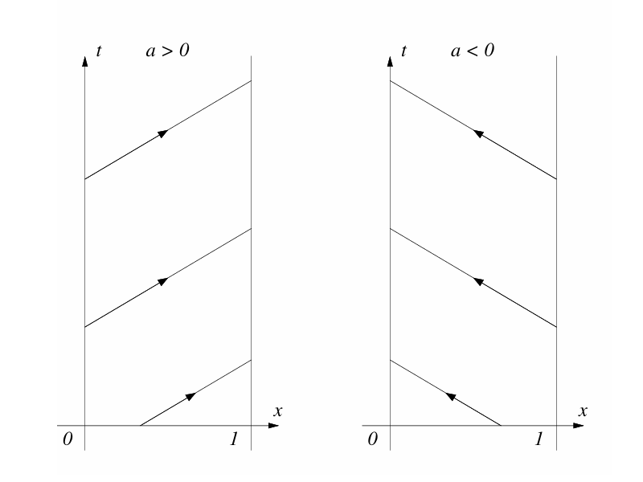
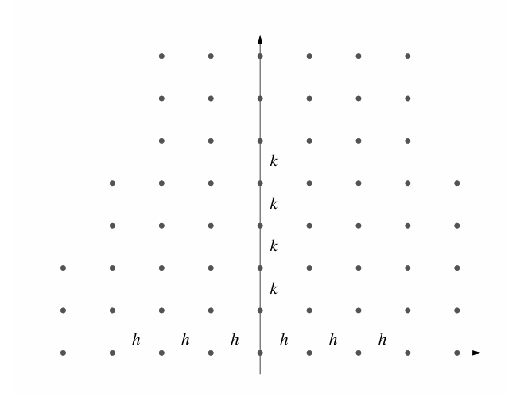
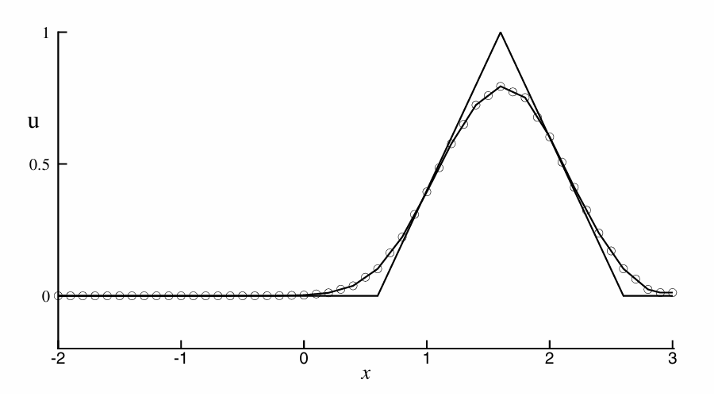
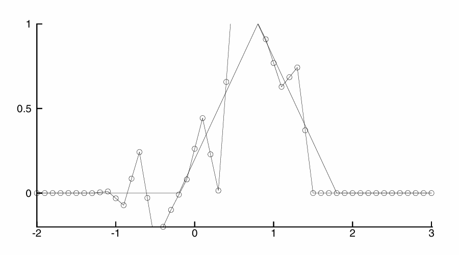
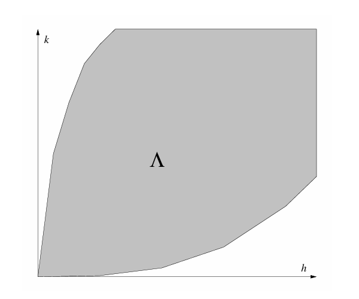
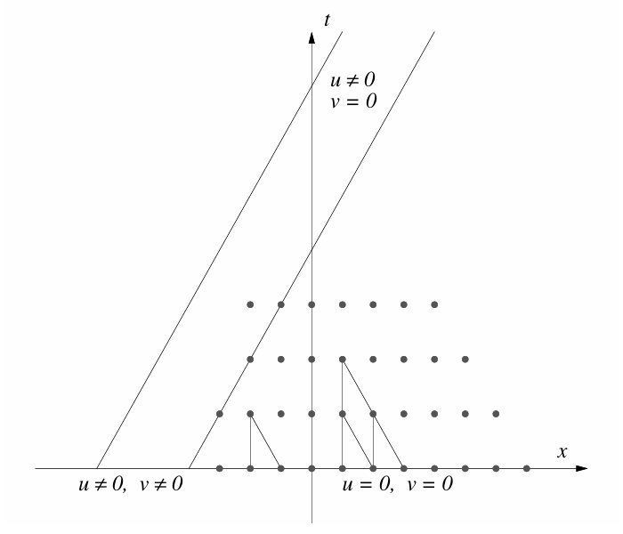

::: {#exm-variable-coefficient-pde}

Consider the variable-form of the PDE where the wave speed $a$ now depends on both position and time.

$$
\begin{aligned}
u_t+a(x, t)u_x & =0 \\
u(x, 0) & =u_0(x)
\end{aligned}
$$ {#eq-variable-coefficient-pde}

:::

::: {#sol-variable-coefficient-pde}

Unlike the simple wave equation with constant $a$, the variable form will have nonlinear characteristic curves. Assume these curves can be described by $(x(t), t)$ where $x(t)$ is some unknown time-dependent function. Note here that we are using $x$ as a function to describe the spatial coordinate of our characteristic curve, as well as the spatial coordinate of the entire PDE. We then proceed to define $g(t)$ as

$$
g(t)=u(x(t), t)
$$

We want to investigate how $g(t)$ behaves across $t$ by taking the partial derivatives and relating to @eq-variable-coefficient-pde. By chain rule, $g'(t)$ is

$$
\frac {\mathrm dg}{\mathrm dt}=g'(t)=\frac {\partial u}{\partial x}\frac {\mathrm dx}{\mathrm dt}+\frac {\partial u}{\partial t}=u_x(x(t), t)x'(t)+u_t(x(t), t)
$$ {#eq-variable-coefficient-g-derivative}

The goal here is to have @eq-variable-coefficient-g-derivative match the PDE in @eq-variable-coefficient-pde such that the RHS is a known function of $t$. Comparing the two directly, we require

$$
x'(t)=a(x(t), t)
$$ {#eq-variable-coefficient-requirement}

If @eq-variable-coefficient-requirement is satisfied, then

$$
g'(t)=a(x, t)u_x(x(t), t)+u_t(x(t), t)=0
$$

In other words, under @eq-variable-coefficient-requirement, $g(t)$ is constant. For most problems we are given the form of $a(x, t)$ as that is the coefficient of $u_x$. Thus, @eq-variable-coefficient-requirement becomes an ODE in $t$ that may be solved to recover the characteristic curve of @eq-variable-coefficient-pde.

The equation of characteristics for this problem is

$$
\left\{
\begin{aligned}
x'(t) & =a(x, t) \\
x(0) & =x_0
\end{aligned}
\right.
$$ {#eq-variable-coefficient-characteristics-equation}

Once $x(t)$ is known, then substitute $t=0$ to compute the initial spatial coordinate $x_0$. The coordinate $(x_0, 0)$ is the position that the characteristic curve emanates from. With $x_0$ and therefore, $u_0(x_0)$ known, then $u(x, t)=u_0(x_0)$ since $g'(t)=0$.

:::

Now let's look at a specific example to illustrate how characteristic curves allow us to evaluate a PDE analytically.

::: {#exm-nonlinear-pde}

Consider the nonlinear PDE below. This is a special case of @eq-variable-coefficient-pde with $a(x, t)=x$.

$$
\begin{aligned}
u_t+xu_x & =0 \\
u(x, 0) & =\begin{cases}1 & \qquad 0\leq x\leq 1 \\0 & \qquad\mathrm{otherwise}\end{cases}
\end{aligned}
$$ {#eq-nonlinear-pde}

:::

::: {#sol-nonlinear-pde}

The initial condition is given as a piecewise constant function that is not continuous and differentiable at all. However, we can still solve this since we allow discontinuous solutions for hyperbolic functions. From @eq-variable-coefficient-characteristics-equation, we have

$$
\left\{
\begin{aligned}
x'(t) & =x \\
x(0) & =x_0
\end{aligned}
\right.
$$

This is a simple ODE that can be solved by separation of variables to obtain $x(t)=x_0e^t$. The characteristic curves for @eq-nonlinear-pde are therefore exponential, following $e^t$ that originate from $(x_0, 0)$. For a given $(x, t)$ whose characteristic curve originates from $(x_0, 0)$, then

$$
x_0=xe^{-t}
$$

Therefore, $u(x, t)$ can be computed as

$$
u(x, t)=u(x_0, 0)=u_0(xe^{-t})
$$

:::

# Boundary Conditions

## Boundary Values

Let's consider the 1D transport problem, $u_t+au_x=0$, restricted to a finite interval. Without loss of generality, we may assume the interval to be $0\leq x\leq 1$. Depending on the value of the wave speed $a$, the characteristic curves may be lines of positive or negative slope as shown below.

{width=50% .lightbox}

We have shown that for the case of $u_t+au_x=0$, the solution $u(x, t)$ is constant along each characteristic $x-at$.

1. If $a>0$, so the characteristics propagate towards the right, then the solution should be specified on the boundary at $x=0$ in addition to the initial data at $t=0$.

   ::: {#rem-solution-contraints}

   No data can be specified at the other boundary, $x=1$ in this case, otherwise you will have an overconstrained equation.

   :::

   Specifying the solution at $x=1$, in addition to the initial data at $t=0$, is also valid as $u(x, t)$ may be solved traveling back towards $x=0$ along the characteristic. But generally, it is more likely that the solution at the $x=0$ boundary be specified.

2. If $a<0$, the solution should be specified at the boundary $x=1$ in addition to the initial data at $t=0$. The solution can then be solved along each characteristic to achieve the solution at the $x=0$ boundary.

## Periodic Problems

The second type of boundary we may encounter are periodic boundaries. To illustrate, we consider the 1D transport equation on the restricted interval $0\leq x\leq 1$. Instead of specifying the value directly at the boundaries, we relate them to each other $\forall t\geq0$.

$$
u(0, t)=u(1, t)
$$

Periodic boundary conditions are equivalent to a PDE being specified on the entire real line $-\infty<x<\infty$ satisfying $u(x+1, t)=u(x, t)$ for all $x$ and $t$.

# Finite Difference Schemes

For finite difference schemes (FDS), the idea is very simple: instead of storing all values of $u(x, t)$ across all time and space, store discrete values of $u$ in a grid and compute the derivatives using its definition. Consider a grid on the $x-t$ plane. Presume that the grid is uniform in space and time as shown below.

{width=50% .lightbox}

The distance between two adjacent grid points spatially is denoted by $h=\Delta x$. Similarly, the distance between two adjacent points along the time axis is denoted by $k=\Delta t$.

1. The grid points are denoted as

   $$
   (x_m, t_n)=(m\Delta x, n\Delta t)=(mh, nk)
   $$

2. Let $v$ be a function defined on the grid. Then we define $v_m^n$ as the value of $v$ at the grid point $(x_m, t_n)$.

3. If $u(x, t)$ is a function defined for continuously varying $(x, t)$, such as the ground-truth solution to the PDE, then we also use $u_^n$ to denote the value of $u$ at the grid point $(x_m, t_n)$. In other words, $u_m^n=u(x_m, t_n)$.

4. The set of points $(x_m, t_n)$ for a fixed value of $n$ is called the grid level $n$. For example, grid level $2$ refers to the collection of points along the grid that make up $(x_m, t_2)$ (e.g., the third row of grid points in the discretized $x-t$ plane).

5. We are interested in grids with small $$.

::: {#def-finite-difference-scheme}

To derive a finite difference scheme from its continuous functional counterpart, replace all derivatives with their finite difference representations. For example, if our PDE contains the partial derivative $\frac {\partial u}{\partial t}$, we may approximate this on a discrete set of points using

$$
\begin{aligned}
\frac {\partial u}{\partial t}(x_m, t_n)=\lim\limits_{k\to0}\frac {u(x_m, t_n+k)-u(x_m, t_n)}k & \approx\frac {u(x_m, t_n+k)-u(x_m,t_n)}k\\ & \approx\frac {u(x_m, t_n+k)-u(x_m, t_n-k)}{2k}
\end{aligned}
$$

Finite differences become more accurate as $k\to0$ per their limit definitions.

:::

Consider the 1D convection equation $u_t+au_x=0$. We have the following five finite difference schemes to approximate and numerically solve this equation.

1. Forward-Time, Forward-Space (FTFS) scheme

   $$
   \frac {v_m^{n+1}-v_m^n}k+a\frac {v_{m+1}^n-v_m^n}h=0
   $$ {#eq-ftfs-scheme}

   We use forward difference schemes to compute both the time and spatial derivatives. For each direction, we step forward in time or space and subtract the current point $v_m^n$ to compute the derivative. For this reason, it is called the forward time and forward space scheme.

2. Forward-Time, Backwards-Space (FTBS) Scheme

   $$
   \frac {v_m^{n+1}-v_m^n}k+a\frac {v_m^n-v_{m-1}^n}h=0
   $$ {#eq-ftbs-scheme}

   The time derivative is identical to @eq-ftfs-scheme as we are stepping forward in time and moving up a grid level when computing $v_m^{n+1}$. However, the spatial term is different: instead of stepping forward to calculate the spatial derivative, we are actually stepping backwards. For this reason, this is called the FTBS scheme.

3. Forward-Time, Central-Space (FTCS) Scheme

   $$
   \frac {v_m^{n+1}-v_m^n}k+a\frac {v_{m+1}^n-v_{m-1}^n}{2h}=0
   $$ {#eq-ftcs-scheme}

4. Leapfrog Scheme

   $$
   \frac {v_m^{n+1}-v_m^{n-1}}{2k}+a\frac {v_{m-1}^n+v_{m+1}^n}{2h}=0
   $$ {#eq-leapfrog-scheme}

   We use central difference schemes for computing both the time and space derivatives. Unlike the previous schemes, we do not use $v_m^n$ in this scheme.

5. Lax-Friedrichs Scheme

   $$
   \frac {v_m^{n+1}-\frac 12\left(v_{m-1}^n+v_{m+1}^n\right)}k+a\frac {v_{m+1}^n-v_{m-1}^n}{2h}=0
   $$ {#eq-lax-friedrichs-scheme}

   Like @eq-leapfrog-scheme, we do not use $v_m^n$ when computing $v_m^{n+1}$. The spatial derivative is computed with central difference, much like @eq-ftcs-scheme. However, the temporal derivative is computed by subtracting a "predicted" value of $v_m^n$ from $v_m^{n+1}$. Instead of directly using $v_m^n$, we compute it from its neighbors, $v_{m-1}^n$ and $v_{m+1}^n$.

::: {#rem-explicit-schemes-linear-combination}

Note that the schemes presented in @eq-ftfs-scheme through @eq-lax-friedrichs-scheme are explicit and can be written by expressing $v_m^{n+1}$ as a linear combination of values of $v$ at grid levels $n$ and $n-1$. For example, with @eq-ftfs-scheme, solve for $v_m^{n+1}$ to get

$$
v_m^{n+1}=(1+a\lambda)v_m^n-a\lambda v_{m+1}^n
$$

where $\lambda=\frac kh=\frac {\Delta t}{\Delta x}$. The variable $\lambda$ is a very important quantity that will play a significant role when analyzing these difference schemes.

:::

::: {#def-one-step-schemes}

Schemes that involve $v$ at only two grid levels, $n+1$ and $n$, are called **one-step schemes**. Given initial condition data $v_m^0$, subsequent grid levels $v_m^1$, $v_m^2$, etc. are computed one step at a time.

Schemes that involve $v$ at more than two grid levels are called **multi-step schemes**. They require knowing how the grid function behaves at multiple grid levels to compute the next one. For example, the Leapfrog scheme given by @eq-leapfrog-scheme requires knowing the values of $v$ at grid levels $n$ and $n-1$ to compute $v_m^{n+1}$. That is, to compute $v_m^2$, we must know $v_m^0$ and $v_m^1$.

Generally, only initial data at $t=0$ is known for a given problem. To apply multi-step schemes, we require applying one-step schemes to determine the behavior of $v_m^1$ and above grid levels, before we may apply the multi-step scheme itself.

:::

::: {#exm-initial-boundary-value-problem}

Consider the 1D transport equation with $a=1$ for $-2\leq x\leq 3$ and $t\geq0$.

$$
\begin{aligned}
u_t+u_x & =0 \\ \\
u_0(x) & =\begin{cases}1-|x| & \qquad|x|\leq1 \\0 & \qquad|x|>1\end{cases} \\ \\
u(-2, t) & =0
\end{aligned}
$$

:::

::: {#sol-initial-boundary-value-problem}

This problem is well-posed since there is an initial condition at $t=0$ and a boundary value specified at $x=-2$ for constant transport. If we implemented a finite difference scheme to numerically solve this problem, we see drastically different behaviors depending on the value of $\lambda$ used. For @exm-initial-boundary-value-problem, we apply @eq-lax-friedrichs-scheme with different values of $\lambda$.

1. With $\lambda=0.8$ and $h=0.1$, the numerical solution is shown below.

   {width=50% .lightbox}

2. With $\lambda=1.6$ and $h=0.1$, the numerical solution is unstable.

   {width=50% .lightbox}

:::

# Convergence and Consistency

For a given scheme used to approximate the solution to a PDE, convergence simply reflects the ability of the numerically computed solution to become closer and closer towards the ground-truth solution as $(h,k)\to(0, 0)$. That is, as the computational grid is refined, the numerical solution become the analytical solution.

We have seen previously with the Lax-Friedrichs scheme that having $(h,k)\to(0, 0)$ is not a sufficient condition for guaranteeing convergence; the path taken by $(h,k)$ also matters.

Consider a linear PDE of the form

$$
P(\partial_t, \partial_x)u=f(x, t)
$$ {#eq-general-linear-pde-form}

The only requirement we have is that @eq-general-linear-pde-form be first-order with respect to *time*. The differential equation itself may contain higher order spatial derivatives (e.g., $u_{xx}$ or $u_{tx}$). Examples of valid PDEs under this requirement include

$$
\begin{aligned}
u_t-bu_{xx}+au_x & =0 \\
u_t+cu_{tx}+au_x & =f(x, t)
\end{aligned}
$$

For each PDE above, the highest order for the time derivative is first order (the $u_{tx}$ term does not count as it is also differentiated with respect to $x$). And lastly, we assume the problem given by @eq-general-linear-pde-form is well-posed, where given an initial condition $u(x_0)=u_0(x)$, there is a unique solution to @eq-general-linear-pde-form.

::: {#def-convergent-scheme}

## Convergent Scheme

A one-step finite difference scheme approximating a PDE is called a convergent scheme if for any solution $u(x, t)$ that satisfies the PDE and solution $v_m^n$ to the finite difference scheme, $v_m^n\to u(x, t)$ as $(mh, nk)\to(x, t)$ and $(h,k)\to0$. We, of course, require that $v_m^0$ converges to $u_0(x)$ as $mh\to x$.

:::

Proving that a finite difference scheme is convergent directly is difficult. However, there are two related concepts that are easy to verify. They are **consistency** and **stability**. Together, these conditions are sufficient to determine whether a finite difference scheme is convergent, as we will see later on.

::: {#def-consistency}

## Consistency

Given a PDE of the form $P(\partial_t, \partial_x)u=f$ and a finite difference scheme $P_{h,k}v=f$, we say that the finite difference scheme is consistent with the PDE if for any smooth function $\phi(x, t)$, we have as $(h,k)\to0$

$$
P\phi-P_{h,k}\phi\to0
$$ {#eq-consistency-definition}

The convergence in this case being the pointwise convergence at each $(x, t)$.

:::

::: {#rem-consistency-restriction}

For some finite difference scheme, we need to restrict the manner in which $(h,k)\to0$ for the scheme to be consistent. To illustrate this, if we imagine $(h,k)$ as two arbitrarily positive numbers in the positive $h-k$ plane, $(h,k)\to0$ describes some sequence or path taken towards the origin.

{#fig-stability-region width=40% .lightbox}

Certain finite difference schemes may be inconsistent for arbitrarily chosen values of $(h,k)$. However, if we restrict our choice to be within a region of stability defined by $\Lambda$, the scheme may become consistent.

We also require $\phi(x, t)$ to be a smooth function, meaning it is sufficiently differentiable for the context of the problem.

:::

::: {#rem-differential-operator-restriction}

The differential operator $P_{h,k}$ when applied to $\phi(x, t)$ does not need to be restricted to the grid. For example, with the forward difference scheme, we have

$$
P_{h,k}\phi(x, t)=\frac {\phi(x+h, t)-\phi(x, t)}h
$$

:::

::: {.callout-note title="Consistency of FTFS Scheme" collapse=true}

Define the differential operator as $P=\partial_t+a\partial_x$. When applied to the arbitrary smooth function $\phi(x, t)$, then

$$
P\phi=\phi_t+a\phi_x
$$ {#eq-example-ftfs-consistency-pde}

The FTFS scheme is

$$
\left(P_{h,k}\phi\right)_m^n=\frac {\phi_m^{n+1}-\phi_m^n}k+\frac {\phi_{m+1}^n-\phi_m^n}h
$$ {#eq-example-ftfs-consistency-differential-operator}

We want to show that as $(h,k)\to0$, then @eq-example-ftfs-consistency-differential-operator for any point becomes @eq-example-ftfs-consistency-pde. To accomplish this, we take the Taylor expansion of each term in $x$ and $t$.

$$
\begin{aligned}
\phi_m^{n+1} & =\phi_m^n+k\phi_t+\frac 12k^2\phi_{tt}+\mathcal O(k^3) \\
\phi_{m+1}^n & =\phi_m^n+h\phi_x+\frac 12h^2\phi_{xx}+\mathcal O(h^3)
\end{aligned}
$$ {#eq-example-ftfs-consistency-taylor-expansion}

In this notation, the derivatives are understood to be evaluated at the point of interest, $(mh, nk)$. Substitute the expansions in @eq-example-ftfs-consistency-taylor-expansion into @eq-example-ftfs-consistency-differential-operator and simplify.

$$
\left(P_{h,k}\phi\right)_m^n=\phi_t+a\phi_x+\frac 12k\phi_{tt}+\frac 12ah\phi_{xx}+\mathcal O(k^2)+\mathcal O(h^2)
$$ {#eq-example-ftfs-consistency-differential-operator-taylor-expansion}

This operator when applied onto $\phi$ is not limited to a certain set of points. That is, we may choose an arbitrary $(x, t)$ to apply @eq-example-ftfs-consistency-differential-operator-taylor-expansion on. We can show that the difference between @eq-example-ftfs-consistency-pde and @eq-example-ftfs-consistency-differential-operator-taylor-expansion becomes zero as $(h,k)\to0$.

$$
P_{h,k}\phi-P\phi=\frac 12k\phi_{tt}+\frac 12ah\phi_{xx}+\mathcal O(k^2)+\mathcal O(h^2)\to0
$$

:::

::: {#nte-lax-friedrichs-scheme-consistency .callout-note title="Consistency of Lax-Friedrichs Scheme" collapse=true}

Maintain the same definition for the differential operator as $P=\partial_t+a\partial_x$. The differential operator for the Lax-Friedrichs scheme is

$$
P_{h,k}\phi=\frac {\phi_m^{n+1}-\frac 12\left(\phi_{m+1}^n+\phi_{m-1}^n\right)}k+a\frac {\phi_{m+1}^n-\phi_{m-1}^n}{2h}
$$

Applying a Taylor expansion to $\phi_{m\pm1}^n$ and $\phi_m^{n+1}$ and substituting, we get

$$
P_{h,k}\phi=\phi_t+a\phi_x+\frac 12k\phi_{tt}-\frac 12\frac {h^2}k\phi_{xx}+\frac 16ah^2\phi_{xxx}+\mathcal O\left(h^4+\frac {h^4}k+k^2\right)
$$ {#eq-example-lax-friedrichs-consistency-differential-operator-taylor-expansion}

The form of @eq-example-lax-friedrichs-consistency-differential-operator-taylor-expansion is very similar to that given in @eq-example-ftfs-consistency-differential-operator-taylor-expansion. However, the rate at which $h\to0$ and $k\to0$ now matter. If $k\to0$ at a much faster rate than $h\to0$, then the $\frac {h^2}k$ term will blow up. Therefore, $P_{h,k}\phi-P\phi\to0$ as $(h,k)\to0$ as long as $\frac {h^2}k\to0$.

Recall that in @exm-initial-boundary-value-problem, we observed how the value of $\lambda$ affects the behavior of the numerical solution when using Lax-Friedrichs. In fact, choosing too large of a $\lambda$ resulted in the numerical solution blowing up. From the consistency proof here, we can conclude that this observed instability is *not* caused by @eq-lax-friedrichs-scheme being inconsistent. The reason for this is if we maintain a constant $\lambda=\frac kh$, as was done in the example, then $\frac {h^2k}=\frac h{\lambda}\to0$ as $(h,k)\to0$ so the scheme is consistent. We will eventually see that the issue arises when proving stability.

:::

Proving consistency is **not** a sufficient condition for proving convergence. We can show that a consistent scheme exists that is not (or even never) convergent! For our example, we consider the FTFS scheme, @eq-ftfs-scheme, applied to $u_t+u_x=0$.

::: {#nte-proof-ftfs-scheme-nonconvergent .callout-note title="Proof FTFS Scheme is Non-Convergent"}

Consider the 1D convection equation with unit wave speed subject to the initial condition

$$
u_0(x)=\begin{cases}1 & \qquad-1\leq x\leq0 \\0 & \qquad\mathrm{otherwise}\end{cases}
$$

The analytical solution to the PDE is given in the image below. The solution at grid point $(x_m,t_n)$ is given by shifting $u_0$ to the right by $t$. The solid diagonal lines in @fig-ftfs-consistent-nonconvergent denote the characteristic lines where $u(x, t)$ becomes nonzero. Outside of this "band", $u(x,t)=0$.

{#fig-ftfs-consistent-nonconvergent width=50% .lightbox}

For the difference scheme, take the initial data to be

$$
v_m^0=\begin{cases}1 & \qquad-1\leq mh\leq 0 \\0 & \qquad\mathrm{otherwise}\end{cases}
$$

From @eq-ftfs-scheme, we can see that $v_m^{n+1}$ is dependent only on $v_m^n$ and $v_{m+1}^n$. Therefore, @eq-ftfs-scheme will predict $v_m^{n+1}=0$ for $x\geq0$ as $v_m^n=0$ and $v_{m+1}^n=0$ in this region. The numerical solution disagrees with the solution presented in @fig-ftfs-consistent-nonconvergent, as it does not predict the sloped characteristic curves that delineate where $u(x,t)\neq0$.

As a result, we may conclude @eq-ftfs-scheme is **nonconvergent**. Yet, we have successfully shown that @eq-ftfs-scheme is **consistent**. Therefore, consistency alone is not a sufficient condition for determining convergence.

:::

# Stability

When performing stability analysis, we only need to consider the homogeneous form of the PDE. That is, if the general form of the differential equation is $Pu=f$, we only need to consider $Pu=0$ in our stability analysis.

::: {#nte-stability-region-definition .callout-note title="Stability Region Definition"}

A stability region $\Lambda$ is any subset of $\mathbb R_{>0}^2$ that has the origin $(0, 0)$ as an accumulation point.

Graphically, in @fig-stability-region, we may imagine a region in the first quadrant of the $h-k$ plane. All values of $(h, k)$ in this region are stable, and this region called $\Lambda$ includes the origin. There is some sequence or path where $(h, k)\to0$ and the scheme remains stable.

:::

::: {#nte-stability-definition .callout-note title="Stability Definition"}

A finite difference scheme $P_{h,k}v_m^n=0$ for a PDE that is first-order in time is stable in a stability region $\Lambda$ if there is an integer $J$ such that for any positive time $T$, there is a constant $C_T>0$ such that

$$
h\sum\limits_{m=-\infty}^{\infty}\left|v_m^n\right|^2\leq C_Th\sum\limits_{j=0}^J\sum\limits_{m=-\infty}^{\infty}\left|v_m^j\right|^2
$$ {#eq-stability-definition}

for $0\leq nk\leq T$ with $(h,k)\in\Lambda$.

:::

**Remarks:**

1. If $\left(\omega_m\right)_{m=-\infty}^{\infty}$ is a function on a spatial grid of $h$, then define the L^2^ norm of the grid function $\omega$ as

   $$
   \lVert\omega\rVert_h=\left(h\sum\limits_{m=-\infty}^{\infty}\left|\omega_n\right|^2\right)^{1/2}
   $$ {#eq-l2-norm-definition}

   The RHS of @eq-l2-norm-definition looks very similar to a Riemann sum. Indeed, the integral form where the infinite sum is replaced with an integral is the continuous L^2^ norm definition. Therefore, @eq-l2-norm-definition defines a discrete L^2^ norm definition that attempts to approximate the continuous L^2^ norm of a function.

   The stability definition in @eq-stability-definition is fundamentally a relationship between the discrete L^2^ norms of $v$.

2. With this notation, we can rewrite @eq-stability-definition as

   $$
   \lVert v^n\rVert_h^2\leq C_T\sum\limits_{j=0}^J\left\lVert v^j\right\rVert_h^2
   $$

   This version of stability says that the L^2^ norm of $v$ at a future time is bounded or controlled by the L^2^ norms at previous time. This is also equivalent to

   $$
   \lVert v^n\rVert_h\leq C_T^*\sum\limits_{j=0}^J\left\lVert v^j\right\rVert_h
   $$ {#eq-stability-definition-l2-norm}

   @eq-stability-definition-l2-norm effectively says that the $h$-norm of the solution at any time $t\leq T$ has an upper limit on its growth; it cannot grow unbounded.

3. The purpose of $J$ is to accommodate the definition for multi-step schemes. For one-step schemes, $J=0$ and the RHS of @eq-stability-definition-l2-norm reduces down to

   $$
   \lVert v^n\rVert_h\leq C_T^*\left\lVert v^0\right\rVert_h
   $$

   The growth at the $n$^th^ time level is bounded by the growth at the initial time. We must choose specific $(h,k)$ such that @eq-stability-definition-l2-norm does not blow up.

To illustrate the essence of stability, we apply @nte-stability-definition to show how @eq-ftfs-scheme is unstable and therefore, cannot be convergent.

::: {#nte-ftfs-scheme-stability .callout-note title="Stability of FTFS Scheme" collapse=true}

Instead of deriving the stability condition valid only for @eq-ftfs-scheme, we may consider the general form of the FTFS scheme and derive a broader stability requirement. Consider the general form of the FTFS scheme below.

$$
v_m^{n+1}=\alpha v_m^n+\beta v_{m+1}^n
$$ {#eq-ftfs-scheme-general-form}

The FTFS scheme for solving $u_t+u_x=0$ is a special case where $\alpha=1+a\lambda$ and $\beta=-a\lambda$. We can show that @eq-ftfs-scheme-general-form is stable if and only if

$$
|\alpha|+|\beta|\leq1
$$ {#eq-ftfs-scheme-general-form-stability-requirement}

To prove this, we take the LHS of @eq-stability-definition and manipulate the LHS to be in terms of $v_m^0$, the initial condition. Substitute the definition of the scheme and apply the triangle inequality theorem.

$$
\begin{aligned}
\sum\limits_{m=-\infty}^{\infty}\left|v_m^{n+1}\right|^2 & =\sum\limits_{m=-\infty}^{\infty}\left|\alpha v_m^n+\beta v_{m+1}^n\right|^2 \\
 & =\sum\limits_{m=-\infty}^{\infty}\alpha^2\left|v_m^n\right|^2+2\left|\alpha\right|\left|\beta\right|\left|v_m^n\right|\left|v_{m+1}^n\right|+\beta^2\left|v_{m+1}^n\right|^2 \\
 & \leq\sum\limits_{m=-\infty}^{\infty}\alpha^2\left|v_m^n\right|^2+\left|\alpha\right|\left|\beta\right|\left(\left|v_m^n\right|^2+\left|v_{m+1}^n\right|^2\right)+\beta^2\left|v_{m+1}^n\right|^2 \\
 & =\sum\sum\limits_{m=-\infty}^{\infty}\alpha^2\left|v_m^n\right|^2+\left|\alpha\beta\right|\left|v_m^n\right|^2+\sum\limits_{m=-\infty}^{\infty}\left|\alpha\beta\right|\left|v_{m+1}^n\right|^2+\beta^2\left|v_{m+1}^n\right|^2
\end{aligned}
$$

Note that in the penultimate equation, we use the fact that $2xy\leq x^2+y^2$. The second summation can be re-indexed such that $v_{m+1}^n\to v_m^n$. The bounds of $m$ remain the same since $-\infty<m<\infty$. Therefore, we get

$$
\sum\limits_{m=-\infty}^{\infty}\left|v_m^{n+1}\right|^2=\sum\limits_{m=-\infty}^{\infty}\left(\left|\alpha\right|^2+2\left|\alpha\right|\left|\beta\right|+\left|\beta\right|^2\right)\left|v_m^n\right|^2=\left(\left|\alpha\right|+\left|\beta\right|\right)^2\sum\limits_{m=-\infty}^{\infty}\left|v_m^n\right|^2
$$

We have managed to relate the L^2^ norm of $v$ at grid level $n+1$ to the L^2^ norm of $v$ at grid level $n$. We may repeat this same process on $\left|v_m^n\right|^2$ to relate it to the L^2^ norm of $v$ at grid level $n-1$. By induction, we can show that the equation above can be related to the initial L^2^ norm.

$$
\sum\limits_{m=-\infty}^{\infty}\left|v_m^n\right|^2\leq\left(\left|\alpha\right|+\left|\beta\right|\right)^{2n}\sum\limits_{m=-\infty}^{\infty}\left|v_m^0\right|^2\leq\sum\limits_{m=-\infty}^{\infty}\left|v_m^0\right|^2
$$ {#eq-ftfs-scheme-stability-relation}

Therefore, the stability condition is

$$
\left|\alpha\right|+\left|\beta\right|\leq C_T=1
$$

:::

We may relate the concept of stability to the well-posedness of a PDE in a similar form as @eq-stability-definition.

::: {.callout-note title="Well-Posedness of a PDE"}

The initial value problem for a homogeneous PDE that is first-order in time, $Pu=0$, is well-posed if for any $T\geq0$, there exists a constant $C_T$ such that any solution $u(x, t)$ satisfies

$$
\int_{-\infty}^{\infty}\left|u(x, t)\right|^2\,\mathrm dx\leq C_T\int_{-\infty}^{\infty}\left|u(x, 0)\right|^2\,\mathrm dx
$$ {#eq-well-posedness-pde-definition}

for $0\leq t\leq T$.

:::